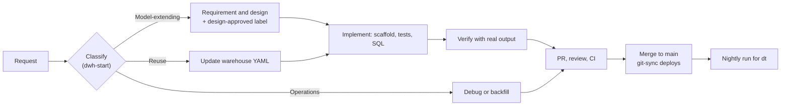
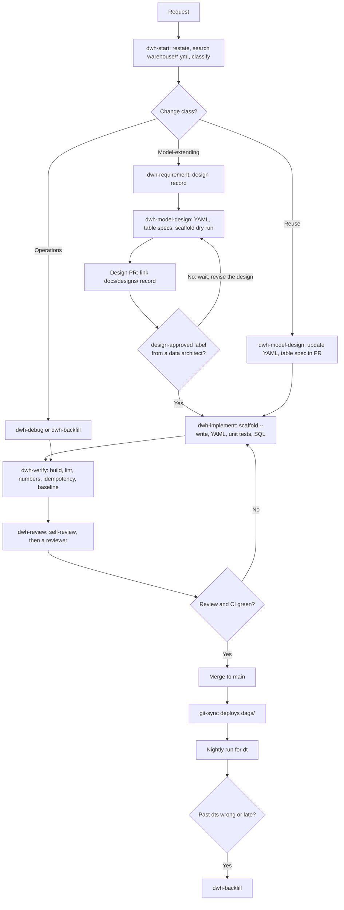
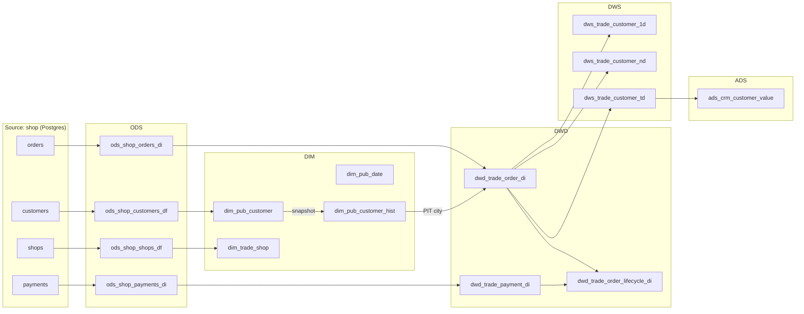
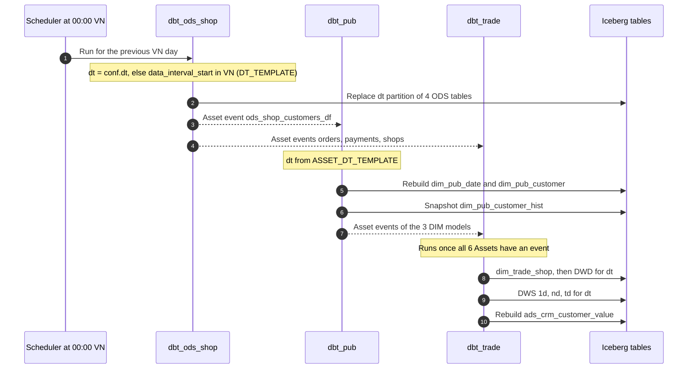
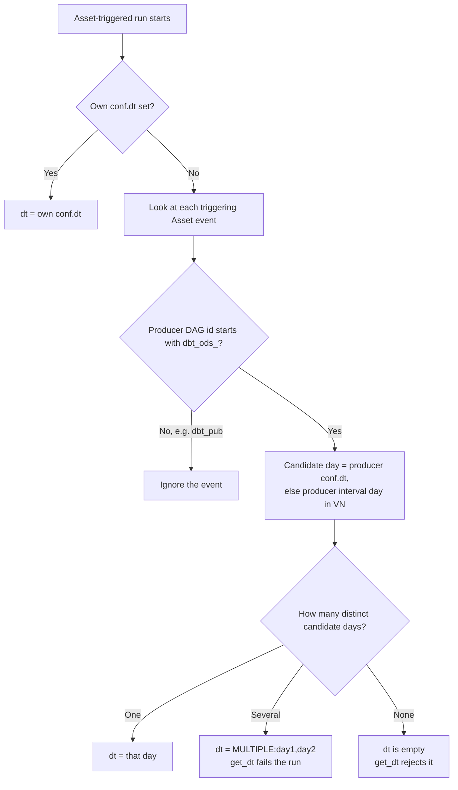
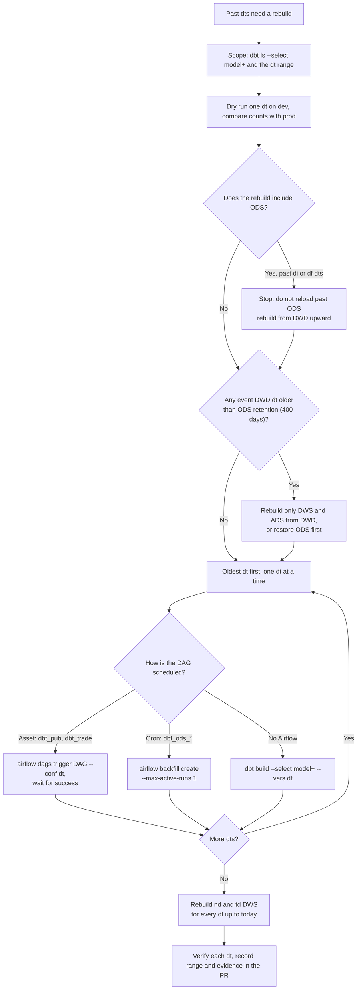

[Tiếng Việt](../../vi/guides/data-model-development.md)

# Data-model development guide

This guide explains how we add or change data in the example-dwh warehouse: from a request to a model that runs
every night. It names the real skills, commands, files and rules of this repository, and uses the `trade`
reference domain (shop orders and payments) as the example throughout.

The rules themselves live in `docs/standards/` and the process steps in `skills/`. This guide does not replace them.
It shows how they fit together. When this guide and a rule file disagree, the rule file wins.

## Contents

1. [Who this is for and how to read it](#1-who-this-is-for-and-how-to-read-it)
2. [Glossary](#2-glossary)
3. [The end-to-end flow](#3-the-end-to-end-flow)
4. [Layers and dependencies](#4-layers-and-dependencies)
5. [The daily run](#5-the-daily-run)
6. [Backfill and late data](#6-backfill-and-late-data)
7. [Walkthrough: how the trade domain was built](#7-walkthrough-how-the-trade-domain-was-built)
8. [Working with AI tools](#8-working-with-ai-tools)
9. [Checklists](#9-checklists)
10. [FAQ](#10-faq)

## 1. Who this is for and how to read it

This guide is for anyone who changes the warehouse: data engineers, analytics engineers, reviewers, data
architects, and the AI coding tools they work with. You need basic SQL. You do not need to know Kimball or Alibaba
OneData already; section 2 explains every term.

How to read it:

- **New to the repo?** Read this section, then the glossary (section 2), then the walkthrough (section 7).
- **About to make a change?** Follow section 3 step by step, and use the checklists in section 9.
- **On call or rebuilding data?** Read sections 5 and 6.

### The process in five minutes

Every data change starts by being **classified**. The class decides the path. A change that adds a new concept to
the warehouse (a domain, a business process, a shared dimension, an atomic metric, a new source system, or a new
grain) is **model-extending**: it needs a written design and a data architect's approval before anyone writes SQL.
A change that only reuses existing concepts is a **reuse** change: it updates the design YAML and goes straight to
code. A failed run, a retry, a backfill or a performance problem is an **operations** change. Every path ends in a
pull request (PR) with real command output as evidence. After merge, git-sync deploys the code, and Airflow builds
each layer every night for the Vietnam business day `dt`.



## 2. Glossary

Terms are grouped by topic. "Where" points to the file or folder that defines or uses the term.

### Layers and design concepts

| Term | Plain meaning | Trade example | Where |
|------|---------------|---------------|-------|
| ODS (operational data store) | A copy of a source table, one partition per day. Only ODS reads `source()`. | `ods_shop_orders_di` | `dags/dbt/models/ods/`, STD-01-02 |
| DIM (dimension layer) | Tables that describe the "who, what, where" of facts, one current row per key. | `dim_pub_customer`, `dim_trade_shop` | `dags/dbt/models/dim/`, `04-dimensions.md` |
| DWD (data warehouse detail) | Atomic fact tables: one row per business event. | `dwd_trade_order_di` | `dags/dbt/models/dwd/`, `05-facts.md` |
| DWS (data warehouse summary) | Summaries of DWD by a grain and one statistical period. | `dws_trade_customer_1d` | `dags/dbt/models/dws/`, `07-dws-ads.md` |
| ADS (application data service) | A table made for one named application or export. | `ads_crm_customer_value` (CRM export) | `dags/dbt/models/ads/`, STD-07-05 |
| Data domain | A business area that owns processes and tables; one token in table names. | `trade`, `crm` | `warehouse/domains.yml`, STD-03-01 |
| Business process | The event that produces facts. One process per fact table. | `order`: "A customer places an order in a shop." | `warehouse/processes.yml`, STD-00-01 |
| Bus matrix | A table of processes against the dimensions each one uses, with role names. | `order` uses `date` as `order_date`, `customer`, `shop` | `warehouse/bus_matrix.yml`, STD-03-03 |
| Conformed dimension | One dimension shared by every process that needs it, so reports agree. | `customer` (scope `pub`) | `warehouse/dimensions.yml`, STD-00-05 |
| `pub` scope | A dimension shared across domains; its table is `dim_pub_<name>`. | `dim_pub_date`, `dim_pub_customer` | STD-02-02 |

### Facts and dimensions

| Term | Plain meaning | Trade example | Where |
|------|---------------|---------------|-------|
| Grain | One sentence saying what one row is: "one row per …". Written before any column. | "One row per order, on the Asia/Ho_Chi_Minh day it was placed." | `processes.yml`, STD-00-02, STD-05-02 |
| Fact | A measured business event, stored in DWD. | an order with its `order_amt` | `05-facts.md` |
| Transaction fact | One row per event; never updated afterwards. | `dwd_trade_order_di`, `dwd_trade_payment_di` | STD-05-01, STD-05-08 |
| Accumulating snapshot | One row per process instance, updated as milestones happen (merged by key). | `dwd_trade_order_lifecycle_di` (placed, then paid) | STD-01-05, STD-08-05 |
| Dimension | Descriptive attributes used to filter and group facts. | `customer` with `customer_name`, `city` | `dimensions.yml` |
| Natural key | The source system's id. Column suffix `_id`. | `customer_id` | STD-02-08 |
| Durable key / surrogate key | `<dimension>_key`: a hash of the natural key (`dbt_utils.generate_surrogate_key`). It stays the same across versions, so a fact can compute it without a lookup. | `customer_key` | STD-04-02, STD-05-06 |
| SCD4 | Slowly changing dimension, type 4: `dim_*` holds the current row; `dim_*_hist` holds every version, from a dbt snapshot of `dim_*`. Our default. | `dim_pub_customer` + `dim_pub_customer_hist` | STD-04-01, STD-04-03 |
| SCD1 | A dimension that keeps no history (only current attributes). | `dim_trade_shop`, `dim_pub_date` | STD-04-04 |
| Historical vs current attribute | Historical: a fact needs the value as it was at event time. Current: read from `dim_*` now. | `customer.city` is historical; `customer_name` is current | `dimensions.yml`, STD-04-04 |
| Point-in-time (PIT) join | Join a fact to `dim_*_hist` on the durable key and `event_at` inside `[valid_from, valid_to)`, and store the value on the fact. | `customer_city` on `dwd_trade_order_di` | STD-05-05 |
| Special members | Two reserved keys in every DIM: `'-1'` Unknown (natural key null or not found) and `'-2'` Not applicable. | `pay_date_key = '-2'` for an unpaid order | STD-04-06 |
| Inferred member | A placeholder DIM row for a key that reached a fact before its dimension row. | (rule only; `is_inferred`) | STD-04-07, STD-12-04 |
| Role-playing dimension | One dimension used several times by a process under role names. | `date` as `order_date` and `pay_date` | STD-04-10 |
| Degenerate dimension | A transaction id kept on the fact, with no DIM table. | `order_id` on `dwd_trade_payment_di` | STD-04-10 |
| Dimension denormalization | Copying a frequently filtered current attribute onto a fact, keeping the `_key`. Not the same as a degenerate dimension. | `shop_name` copied next to `shop_key` | STD-05-07 |

### Metrics

| Term | Plain meaning | Trade example | Where |
|------|---------------|---------------|-------|
| Atomic metric | Process + measure + aggregation (`sum`, `count`, `count_distinct`, `min`, `max`). No period, no filter. | `order_amt` (sum of order amount) | `metrics.yml`, STD-06-01 |
| Modifier | A typed business filter, declared once and reused. | `app` (`channel = 'app'`, type `channel`) | `modifiers.yml`, STD-06-05 |
| Statistical period | The time window of a derived metric: `1d` (the dt day), `nd` (last n days, n fixed by the metric), `td` (all history to dt), `1w` (last 7 days, split out of a wide `nd` table); also `hh`, `mm`. | `1d`, `nd` with `days: 30`, `td` | `periods.yml`, STD-06-06 |
| Derived metric | Atomic metric + one period + optional modifiers + grain. Name: `{modifiers}_{atomic}_{agg}_{period}`. | `app_order_amt_sum_1d`, `order_amt_sum_30d` | `metrics.yml`, STD-06-02, STD-06-04 |
| Calculated metric | A formula over derived metrics, for ratios and averages. Never stored below ADS. | `avg_order_amt_td = order_amt_sum_td / nullif(order_cnt_td, 0)` | STD-06-03, STD-07-06 |
| Additivity | Whether a metric can be summed across every dimension (`additive`, `semi_additive`, `non_additive`). | `order_amt` is additive | STD-05-04 |

### Time, partitions and loads

| Term | Plain meaning | Trade example | Where |
|------|---------------|---------------|-------|
| `dt` | The partition date: the Asia/Ho_Chi_Minh business day, not the UTC date and not the run day. Models read it with `get_dt()`. | `dt = 2026-11-02` | STD-08-01, STD-08-02, `macros/get_dt.sql` |
| Partition | One `dt` slice of an Iceberg table. The unit of load, re-run, backfill and retention. | `dwd_trade_order_di` partition `2026-11-02` | STD-08-01 |
| Partition replacement | An `is_incremental()`-guarded `pre_hook` deletes the `dt` partition, then the model appends. Re-runs are safe. | every ODS, DWD (transaction) and DWS model | STD-08-04 |
| `di` source | Daily incremental: the rows whose watermark (e.g. `updated_at`) falls in the dt day. | `shop.orders`, `shop.payments` | STD-08-06 |
| `df` source | Daily full: a full copy of the table each day. | `shop.customers`, `shop.shops` | STD-08-06 |
| Watermark | The column that decides which `di` rows belong to a day. | `updated_at` | STD-08-06 |
| Late data | A fact that reaches the warehouse after its `dt` was loaded. Handled only by re-running the affected dts. | orders 2 and 4 of the test fixture | STD-08-07 |
| Backfill | Re-running past `dt` partitions, oldest first, one at a time. | after a logic fix in `dwd_trade_order_di` | `skills/dwh-backfill/` |
| Retention | How long each layer keeps old partitions: ODS 400 days, DWD and DWS 3 years, DIM and `_hist` forever, ADS 400 days. | override with `config.meta.retention_days` | STD-08-08 |

### Orchestration

| Term | Plain meaning | Trade example | Where |
|------|---------------|---------------|-------|
| DAG | An Airflow workflow. One per source system (`dbt_ods_<source>`) and one per domain (`dbt_<domain>`). | `dbt_ods_shop`, `dbt_pub`, `dbt_trade` | `dags/`, STD-11-01 |
| Cosmos | The library that turns a dbt selection into an Airflow DAG (`cosmos.DbtDag`), one task per dbt node, and emits an Asset per model. | `dbt_dag_kwargs(select=["tag:ods_shop"])` | `dags/_common/dbt.py`, STD-11-02 |
| Asset / asset-triggered DAG | An Airflow Asset names a table. A DAG scheduled on Assets runs when their producers finish, instead of polling with a sensor. | `dbt_trade` waits on six Assets | `dags/_common/assets.py`, STD-11-04 |
| `conf.dt` | The `dt` you pass to a manual run or backfill: `--conf '{"dt": "2026-11-02"}'`. It overrides the computed day. | `airflow dags trigger dbt_trade --conf '{"dt": "2026-11-02"}'` | `dags/_common/dates.py` |
| `DT_TEMPLATE` / `ASSET_DT_TEMPLATE` | The Jinja templates that compute `dt` in cron DAGs and in asset-triggered DAGs. | see section 5 | `dags/_common/dates.py`, STD-11-03 |
| git-sync | The sidecar that clones `main` into Airflow (`subPath: dags`). Merging is deploying. | `deploy/helm/values.example.yaml` | README "How it runs in production" |

### Process and tooling

| Term | Plain meaning | Trade example | Where |
|------|---------------|---------------|-------|
| Change class | `Model-extending`, `Reuse` or `Operations`, chosen by `dwh-start`. If two fit, take the higher; if unsure, it is model-extending. | adding `trade` was model-extending | `skills/dwh-start/` |
| Design record | `docs/designs/YYYY-MM-DD-<topic>.md`: request, process, grain, dimensions, metrics, sources, consumers, open questions. | `docs/designs/2026-11-04-trade-reference-domain.md` | `skills/dwh-requirement/` |
| Design gate / `design-approved` | A PR that adds a domain, process, dimension or atomic metric must link a design record and carry the `design-approved` label, added by a data architect. CI checks it (DWH-G01, DWH-G02). | | `.github/workflows/design-gate.yml`, STD-03-05 |
| Scaffold | `dwh scaffold` prints (or with `--write` creates) a new model's `.sql` and `.yml` from the design, with tests and empty descriptions. | `dwh scaffold dws_trade_customer_1d ...` | `tools/dwh/`, STD-09-07 |
| Contract | dbt's enforced column list and types on DIM, DWD and DWS. A build fails if the SQL returns other columns or types. | `contract: {enforced: true}` | STD-09-03 |
| Lint codes `DWH-*` | Machine checks, `DWH-<family><two digits>`: Y (YAML), N (naming), L (layers), M (metrics), B (bus matrix), T (tests), D (descriptions), S (sources), G (design gate), R (rulebook). | `DWH-L04` "dependency not allowed by the layer rules" | `tools/dwh/src/dwh/codes.py` |
| Rule IDs `STD-NN-MM` | Every rule in the rulebook; `NN` is the file (`00`–`12`). Each rule is MUST or SHOULD and has a correct and an incorrect example. | STD-07-04 "Build DWS only when it pays" | `docs/standards/` |
| Skill | A short process document (steps, red flags) that a person or an AI tool follows for one phase. There are eight. | `dwh-verify` | `skills/*/SKILL.md` |
| Eval | A headless test scenario that checks whether the skills change an AI agent's behaviour, graded by an LLM judge. | `evals/scenarios/scaffold-dws.md` | `evals/` |

## 3. The end-to-end flow

The diagram shows every step from request to nightly run. Model-extending changes pass the design gate; reuse
changes skip it; operations changes skip design entirely. A review finding or a red CI check sends you back.



The subsections below cover each step: the skill, what goes in and out, the commands, the rules most often cited,
and common mistakes. In the commands, `dwh` stands for `uv run --project tools/dwh dwh`.

### 3.1 Request

- **Skill:** none yet.
- **In:** a question from a person, for example "the CRM team needs the average order amount per customer".
- **Out:** a request you can restate in one sentence: the business question, who consumes the answer, and the
  deadline.
- **Common mistakes:** starting from the report layout instead of the business process (`dwh-requirement` red
  flag).

### 3.2 Classify

- **Skill:** `dwh-start`. Every data change starts here, including "urgent, just write the SQL".
- **In:** the request.
- **Out:** the first line of your answer: `Class: <class>. Path: <skills>.`
- **How:** search what already exists in `warehouse/processes.yml`, `dimensions.yml`, `bus_matrix.yml`,
  `metrics.yml`, `modifiers.yml` and `glossary.yml` (or the catalogue from `make catalog`). Then pick the class:

| Class | Signals | Path |
|-------|---------|------|
| Model-extending | new domain, business process, conformed dimension or atomic metric; a grain change; a new source system | dwh-requirement → dwh-model-design → stop for human approval → dwh-implement → dwh-verify → PR |
| Reuse | derived metric from an existing atomic metric; new ADS table; new attribute on an existing dimension; logic or bug fix | dwh-model-design (no approval stop) → dwh-implement → dwh-verify → PR |
| Operations | failed DAG or task, retry, backfill, performance | dwh-debug or dwh-backfill → PR |

- **Rules:** STD-00-03 (reuse before create), STD-03-05 (model-extending changes need approval).
- **Common mistakes:**
  - "This metric is obviously new." Most "new" metrics are derived from an existing atomic metric.
  - "It's for a dashboard, so it needs a DWS." A DWS needs two consumers or performance evidence (STD-07-04).

### 3.3 Requirement (model-extending only)

- **Skill:** `dwh-requirement`. It changes no YAML and no SQL.
- **In:** the classified request.
- **Out:** `docs/designs/YYYY-MM-DD-<topic>.md` with the sections Request, Business process, Grain, Dimensions
  (reused / new), Metrics (reused / new), Sources, Consumers, Open questions.
- **How:** name the business process; write the grain as "one row per …"; list dimensions (who, what, where, when,
  how) and decide for each attribute whether it is historical or current; split each requested number into atomic
  metric + period + modifiers + grain; list each source table's load (`di`/`df`), watermark, timezone and delete
  handling; name the consumers. Ask the requester one question at a time until "Open questions" is empty.
- **Rules:** STD-00-01, STD-00-02, STD-05-01, STD-06-01 to STD-06-03.
- **Common mistakes:**
  - "Grain: daily summary" for a new fact. A summary is a DWS built on an atomic DWD.
  - A new atomic metric whose process and measure already exist under another name.

### 3.4 Model design

- **Skill:** `dwh-model-design`.
- **In:** the design record (model-extending) or the agreed reuse change.
- **Out:** updated `warehouse/*.yml`, a table specification per table, and a scaffold dry run per new model.
- **Commands:**

```bash
make validate   # until it reports 0 finding(s)
uv run --project tools/dwh dwh scaffold dws_trade_customer_1d --from dwd_trade_order_di --grain customer_key \
  --metric order_amt_sum_1d order_cnt_1d   # no --write: prints the files, shows naming and design errors
```

- **How:** edit the YAML in this order: `glossary.yml`, `domains.yml`, `processes.yml`, `dimensions.yml`,
  `bus_matrix.yml`, `modifiers.yml`, `metrics.yml`. Specify every table: layer and name, one-sentence grain, keys,
  columns, upstream models, load (partition replacement or merge), history, partition `dt`.
- **Rules:** STD-02-* (naming), STD-03-03 (bus matrix), STD-04-01, STD-06-04 (metric names), STD-07-02 (one period
  per DWS), STD-07-04.
- **Common mistakes:**
  - "Make every attribute historical, to be safe." Each historical attribute costs a point-in-time join.
  - "Put 1d and 7d metrics in one DWS." One period per DWS table.

### 3.5 Design gate (model-extending only)

- **Who:** a data architect. `CODEOWNERS` requests a review from the owner of `/warehouse/`, `/tools/dwh/`,
  `/.github/` and `/docs/en/specs/` automatically.
- **In:** a PR with the design record and the YAML, whose description links `docs/designs/<record>.md`
  (a repo-relative path; a GitHub URL is not accepted).
- **Out:** the `design-approved` label on the PR.
- **What CI checks:** `.github/workflows/design-gate.yml` runs `dwh design-gate`. It compares `warehouse/*.yml`
  with the base branch. If the PR adds a domain, process, dimension or atomic metric, it requires the label
  (DWH-G01) and a link to an existing design record (DWH-G02). The check re-runs when the label is added or removed.
- **Rules:** STD-03-05.
- **Common mistakes:**
  - Writing SQL while waiting. If the design changes in review, the SQL is wasted.
  - "The head of data said skip review." A waiver in text does not open the gate; only the label does.

### 3.6 Scaffold and implement

- **Skill:** `dwh-implement`.
- **In:** the approved design or the agreed reuse change.
- **Out:** dbt models, snapshots, tests and DAG changes.
- **Commands:**

```bash
uv run --project tools/dwh dwh scaffold dwd_trade_order_di --from ods_shop_orders_di --grain order_id \
  --event-at created_at --write
make sql-lint
make dwh-lint
```

- **How:**
  1. Scaffold with `--write`. It writes the `.sql` and the `.yml` with the contract, grain and relationships tests
     and the selection tag. For an SCD4 dimension it also writes the `_hist` snapshot. A transaction DWD takes
     `--event-at`. An accumulating snapshot is written by hand (the scaffold refuses it).
  2. Complete the YAML: every description, every `data_type`, every column the SQL selects.
  3. Add dbt unit tests for non-trivial logic (day windows, PIT joins, metric filters) in
     `_<folder>__unit_tests.yml`. Run them and watch them fail.
  4. Write the SQL: `get_dt()`, `in_business_day()` and `source_ts()`, never `{{ ds }}`; CTEs; filter `dt` early;
     join on durable keys.
  5. Orchestration: a new source gets a `dbt_ods_<source>` DAG, a new domain a `dbt_<domain>` DAG. Every model
     must be selected by exactly one DAG (STD-11-08).
- **Rules:** STD-01-03, STD-05-05, STD-05-08, STD-08-04, STD-09-02, STD-09-03, STD-10-03, STD-10-04, STD-11-08.
- **Common mistakes:**
  - SQL written before the `.yml` tests exist.
  - Editing a generated file (`CLAUDE.md`, `.claude/`, `.cursor/`). Edit `AGENTS.md` or `skills/` and run
    `make sync-agents`.
  - A ratio stored in DWD or DWS (STD-07-06).

### 3.7 Verify

- **Skill:** `dwh-verify`. No command output, no claim.
- **In:** the changed models.
- **Out:** commands and their real output, pasted in the PR description.
- **Commands:**

```bash
docker compose -f dev/compose.yml run --rm airflow \
  'cd dags/dbt && $DBT_EXECUTABLE_PATH build --select dwd_trade_order_di+ --vars "{dt: 2026-11-02}"'
make dwh-lint
make sql-lint
make lint
```

- **How:**
  1. Build the changed dt on dev: every model, unit test and data test must pass.
  2. Lint: each of `make dwh-lint`, `make sql-lint` and `make lint` reports 0 findings.
  3. Numbers: rows per dt against the source, grain uniqueness, one amount reconciled across each hop (ODS ↔ DWD,
     DWD ↔ DWS). The event-day query is in STD-12-03.
  4. Idempotency: build the same dt twice; the counts must not change.
  5. Performance baseline: wall time, input rows and bytes, output rows, Iceberg file count and size (STD-12-05).
- **Rules:** STD-00-06, STD-12-03, STD-12-05.
- **Common mistakes:**
  - "I verified a different dt." Verify the dt you changed, plus the next one.
  - "I'll add the evidence after review." Reviewers cannot check a claim without its output.

### 3.8 Review

- **Skill:** `dwh-review`, for your own PR before asking, and for someone else's.
- **In:** the PR.
- **Out:** findings marked **Critical** (wrong numbers or data loss), **Important** (a rule broken, missing tests or
  evidence) or **Minor**, each with `file:line` and a rule ID. Approve only with no Critical or Important finding.
- **How:** run `make dwh-lint` and `make sql-lint` and quote the result, then check the ten items in section 9.2.
- **Common mistakes:** trusting the linters for grain and fan-out. They cannot tell whether the grain columns are
  the right ones (STD-05-02).

### 3.9 PR and CI

- **In:** the branch, pushed.
- **Out:** green checks.
- **What runs:**
  - `ci.yml`, job `lint`: `make lint`, `make sql-lint`, `make test-repo`, `make dwh-test`, `make validate`,
    `make dwh-lint`, `make check-standards`, `make sync-agents-check`.
  - `ci.yml`, job `stack`: `make image`, `make dev-up`, `make smoke`, `make test-dags`, `make test-integration`,
    `make e2e` on a local Trino, Postgres and RustFS stack.
  - `design-gate.yml`: `dwh design-gate` (section 3.5).
- **Locally first:** `make pre-commit-install` once, then `make pre-commit` runs the same hooks on all files
  (ruff, sqlfluff, `dwh validate`, `dwh lint --changed`, `dwh sync-agents --check`, `dwh check-standards`).
- **Common mistakes:** skipping the local hooks. CI runs the same checks, so a skipped hook is caught on the PR,
  but later.

### 3.10 Merge and deploy

- **How:** merge to `main`. git-sync pulls the repo into Airflow, checking every 60 seconds (`period: 60s`,
  `subPath: "dags"` in `deploy/helm/values.example.yaml`); Airflow parses only `dags/`. There is no separate deploy
  step for SQL or DAGs.
- **Exception:** dbt packages are baked into the image. Changing `dags/dbt/packages.yml` requires a new image.
- **Also on merge:** `.github/workflows/catalog.yml` runs `make catalog` and publishes the design catalogue (bus
  matrix, metric dictionary, glossary, dbt docs) to GitHub Pages.
- **Common mistakes:** expecting a merged model to have history. It starts with the next nightly run; older days
  need a backfill (section 6).

### 3.11 Daily run and backfill

After merge, the model runs every night (section 5). If past partitions are wrong or late rows arrive, rebuild them
with `dwh-backfill` (section 6). A failed run or a number that does not match goes to `dwh-debug` first: locate the
first layer that disagrees, capture the cause in a failing test, fix at the lowest wrong layer, then backfill.

## 4. Layers and dependencies

Layers point down (AGENTS.md non-negotiable 4, STD-01-03):

- only ODS reads `source()`;
- DIM and DWD read ODS and DIM;
- DWS reads DWD, DIM and (coarser-grain) DWS;
- ADS reads DWS and DIM. It may read DWD only when its `.yml` sets `config.meta.dwd_reason` (STD-01-04).

Two special cases: an accumulating-snapshot DWD reads the transaction DWDs of its process (STD-01-05), and a
`_hist` snapshot reads its current `dim_*`. `dwh lint` checks every `ref()` against these rules (DWH-L03, DWH-L04).

The trade domain's real models:



Notes on the diagram:

- `dim_pub_date` is generated (2020-01-01 to 2030-12-31) and has no upstream.
- The DWD and DWS models also declare `-- depends_on:` the DIMs they hold keys for, so the DIMs build first. The
  keys themselves are hashes, computed without a join; only `customer_city` needs the `_hist` join.
- BI tools read the DWD + DIM star directly (STD-01-07, spec D13). `ads_crm_customer_value` exists only because
  the CRM export is a named application.

## 5. The daily run

Three DAGs build the trade domain every night, plus one weekly maintenance DAG.

| DAG | File | Schedule | Selects |
|-----|------|----------|---------|
| `dbt_ods_shop` | `dags/sources/dbt_ods_shop.py` | `daily_vn()`: cron `0 0 * * *` in Asia/Ho_Chi_Minh | `tag:ods_shop` |
| `dbt_pub` | `dags/transform/dbt_pub.py` | Asset of `ods_shop_customers_df` | `tag:domain:pub` |
| `dbt_trade` | `dags/transform/dbt_trade.py` | all six Assets: `ods_shop_orders_di`, `ods_shop_payments_di`, `ods_shop_shops_df`, `dim_pub_customer`, `dim_pub_date`, `dim_pub_customer_hist` | `tag:domain:trade`, `tag:app:crm` |
| `iceberg_maintenance` | `dags/maintenance/iceberg_maintenance.py` | cron `0 3 * * 0` in Asia/Ho_Chi_Minh (Sundays 03:00) | all dt-partitioned ODS, DWD, DWS, ADS models |



### How `dt` is chosen

The code is in `dags/_common/dates.py`; `get_dt()` in `dags/dbt/macros/get_dt.sql` reads and checks the value.

**Cron DAGs (`dbt_ods_*`) use `DT_TEMPLATE`:** `dt` is the run's `conf.dt` if set; otherwise the start of the
run's data interval, converted to Asia/Ho_Chi_Minh, formatted `YYYY-MM-DD`. `daily_vn()` fires at 00:00 Vietnam
time, and each run covers the previous Vietnam day `[00:00, 24:00)`. So the run that fires at 00:00 on 3 November
builds `dt = 2026-11-02`.

**Asset-triggered DAGs (`dbt_pub`, `dbt_trade`) use `ASSET_DT_TEMPLATE`.** Such a run has no cron interval of its
own, so the day comes from the runs that triggered it:



What this means in practice:

- A manual run of `dbt_pub` or `dbt_trade` must pass `conf.dt`; it wins outright.
- A manual `dbt_ods_shop` run for a past day (with `conf.dt`) hands that day to its consumers.
- Events from `dbt_pub` never set `dbt_trade`'s day, even with a `conf.dt`. Only `dbt_ods_*` runs do. A manual
  `dbt_pub` run therefore does not set `dbt_trade`'s day: trigger `dbt_trade` yourself.
- If producer runs of different days collapse into one run (a failed night, a failed ODS task, a ranged ODS
  backfill), the template renders `MULTIPLE:<day>,<day>` (oldest first) and `get_dt()` raises an error naming the
  days. One run builds exactly one dt, so guessing would leave the other days unbuilt with nothing failing. Rerun
  the DAG by hand once per listed day with `conf.dt`, oldest first (section 6).
- With no `dt` variable at all (a manual dev run), `get_dt()` falls back to yesterday in Vietnam. This is for dev
  only.

Never use Airflow's `{{ ds }}`: it is the UTC date of the logical date and is one day off for a schedule that fires
at midnight in Vietnam (STD-08-02).

### Retention and Iceberg maintenance

The weekly `iceberg_maintenance` DAG runs `dbt run-operation iceberg_maintenance --args '{dry_run: false}'`. The
macro (`dags/dbt/macros/maintenance.sql`) takes every model of the ODS, DWD, DWS and ADS layers that is partitioned
by `dt` and, for each one that exists:

1. deletes the `dt` partitions older than `config.meta.retention_days`, or the layer default (ODS 400 days, DWD
   1095, DWS 1095, ADS 400);
2. runs `optimize`, `expire_snapshots(retention_threshold => '7d')` and `remove_orphan_files(retention_threshold =>
   '7d')`.

DIM tables and snapshots are kept forever. `ads_crm_customer_value` is a full table without a `dt` partition, so
retention does not prune it. Retention limits what a backfill can rebuild (section 6).

## 6. Backfill and late data

Use `dwh-backfill` when past `dt` partitions must be rebuilt: after a logic fix, late-arriving data, a source
correction, or a new model that needs history. Late facts are handled only this way: re-run the affected dts;
never patch rows, never load earlier days into today's partition (STD-08-07).



The rules behind the diagram:

- **Oldest first, one dt at a time, never in parallel.** Parallel writes to one Iceberg table conflict and retry.
  Each run replaces its own partition, so re-running a DWD, DWS or ADS dt is safe.
- **Do not reload past ODS.**
  - A `df` source holds only today's state, so a past `df` ODS partition cannot be recreated from it.
  - Re-running a past `di` ODS dt reloads the rows whose `updated_at` falls in that day now. Rows updated again
    later are lost. Do not re-run past `di` ODS dts unless the source keeps history.
- **Late rows still land.** An event DWD run for dt D reads every ODS partition from D onward and keeps the earliest
  version of each key (STD-05-08). Re-running D picks up rows that reached ODS after D. Orders 2 and 4 of the trade
  fixture work this way.
- **Downstream through today.** Rebuild every downstream model, and the `nd` and `td` DWS tables for every dt from
  the earliest changed dt to today, because a `td` value depends on every earlier day.
- **Trigger asset-scheduled DAGs by hand:**

```bash
airflow dags trigger dbt_trade --conf '{"dt": "2026-11-02"}'   # wait for success, then the next dt
airflow backfill create --dag-id dbt_ods_shop --from-date 2026-11-02 --to-date 2026-11-02 --max-active-runs 1
```

- **`dt MULTIPLE:<day>,<day>`.** Trigger that DAG by hand once per listed day with `conf.dt`, oldest first, waiting
  for each run; then rebuild the windowed DWS. Picking one day leaves the others unbuilt, and nothing fails.
- **Retention red flags.**
  - Never re-run an event DWD dt older than the ODS retention (400 days): the pre-hook deletes the partition and the
    pruned ODS days no longer hold its rows, so the partition ends up empty.
  - A `td` DWS sums only the DWD days still retained (3 years). Once older DWD days are pruned, a rebuilt `td` is
    smaller than the original.
- **Leave history alone.** Re-running snapshots does not rebuild `dim_*_hist`. A missed snapshot day loses those
  versions for good (STD-11-08). Rebuild history only with an approved, written plan.
- **Verify each dt** with `dwh-verify` steps 3–4 (numbers and idempotency), and record the range and the evidence
  in the PR.

- **Do not trigger `dbt_pub` for a rebuild from DWD upward.** Its DIMs are current-state tables that read no `dt`.
  A manual `dbt_pub` run also leaves its DIM events queued for `dbt_trade`, so every later night `dbt_trade` starts
  beside `dbt_pub` instead of after it (measured; `docs/en/verification/2026-11-05-plan4-followups.md`). When
  `dbt_pub` must run by hand, clear the queue afterwards:
  `curl -X DELETE <airflow>/api/v2/dags/dbt_trade/assets/queuedEvents`.

## 7. Walkthrough: how the trade domain was built

The `trade` domain (plus the `crm` application layer) was built by following the skills. Its design record is
`docs/designs/2026-11-04-trade-reference-domain.md`.

### Step 1: classify

The request added two domains (`trade`, `crm`), three processes, two new dimensions and new atomic metrics. Each of
these is a model-extending signal:

```text
Class: Model-extending. Path: dwh-requirement → dwh-model-design → stop for human approval → dwh-implement →
dwh-verify → PR.
```

### Step 2: process and grain (dwh-requirement)

The design record names one process per fact table and one grain sentence each:

| Process | Fact type | Grain |
|---------|-----------|-------|
| `order` | transaction | one row per order, on the Asia/Ho_Chi_Minh day it was placed |
| `payment` | transaction | one row per payment, on the day it was captured |
| `order_lifecycle` | accumulating snapshot | one row per order, updated when it is paid |

The same grains went into `warehouse/processes.yml`:

```yaml
processes:
  - name: order
    domain: trade
    description: A customer places an order in a shop.
    fact_type: transaction
    grain: One row per order, on the Asia/Ho_Chi_Minh day it was placed.
```

Each source was declared with its load type: `shop.orders` and `shop.payments` are `di` (watermark `updated_at`);
`shop.customers` and `shop.shops` are `df` (a full copy per day).

### Step 3: dimensions and the bus matrix (dwh-model-design)

`customer.city` is historical, because an order must show the city the customer had when ordering.
`customer_name` is only read now, so it stays current. `shop` keeps no history (`scd1`).

An excerpt of `warehouse/bus_matrix.yml`. `date` plays two roles in the lifecycle process:

```yaml
bus_matrix:
  - process: order
    dimensions:
      - {dimension: date, role: order_date}
      - {dimension: customer}
      - {dimension: shop}
  - process: order_lifecycle
    dimensions:
      - {dimension: date, role: order_date}
      - {dimension: date, role: pay_date}
      - {dimension: customer}
      - {dimension: shop}
```

### Step 4: metrics (dwh-model-design)

Each requested number was split into an atomic metric and its derived forms. The CRM's average order amount is a
calculated metric over two stored derived metrics, so no ratio is stored in DWS. From `warehouse/metrics.yml`:

```yaml
atomic:
  - name: order_amt
    process: order
    description: Total amount of an order.
    aggregation: sum
    additivity: additive
derived:
  - name: order_amt_sum_td
    atomic: order_amt
    period: td
    grain: [customer]
    description: Order amount per customer over all history.
calculated:
  - name: avg_order_amt_td
    formula: order_amt_sum_td / nullif(order_cnt_td, 0)
    inputs: [order_amt_sum_td, order_cnt_td]
    description: Average order amount per customer over all history.
```

The design record also justifies the DWS tables (STD-07-04): two consumers, the ADS `ads_crm_customer_value` and
the finance dashboard. One period per table: 1d, nd (30 days) and td are three tables.

### Step 5: the design gate

The design record and the YAML went into a PR that linked `docs/designs/2026-11-04-trade-reference-domain.md`. No
SQL was written until a data architect added `design-approved`.

### Step 6: scaffold, layer by layer

Each model started from `dwh scaffold --write`, in layer order: ODS, then DIM and DWD, then DWS, then ADS. These are
the README's commands (shown without `--write`, which prints the files):

```bash
dwh="uv run --project tools/dwh dwh"
$dwh scaffold ods_shop_orders_di --grain order_id
$dwh scaffold dim_pub_customer --from ods_shop_customers_df   # also writes dim_pub_customer_hist
$dwh scaffold dwd_trade_order_di --from ods_shop_orders_di --grain order_id --event-at created_at
$dwh scaffold dws_trade_customer_1d --from dwd_trade_order_di --grain customer_key \
  --metric order_amt_sum_1d order_cnt_1d
$dwh scaffold ads_crm_customer_value --from dws_trade_customer_td --grain customer_key \
  --metric order_amt_sum_td avg_order_amt_td
```

`dim_pub_date` was written by hand (the scaffold needs an upstream), and so was `dwd_trade_order_lifecycle_di`
(the scaffold refuses accumulating snapshots). Descriptions, tests and SQL were then filled in until `dwh lint` and
`dbt test` were clean.

### Step 7: the point-in-time join

`dwd_trade_order_di` stores the customer's city as it was when the order was placed. It joins
`dim_pub_customer_hist` on the durable key and the event time. Each key's earliest version is treated as valid
since 1900, so an order placed before the first snapshot takes the first known version. Shortened from the model:

```sql
history as (
    select
        customer_key,
        city,
        case
            when valid_from = min(valid_from) over (partition by customer_key)
                then timestamp '1900-01-01 00:00:00 UTC'
            else valid_from
        end as valid_from,
        valid_to
    from {{ ref('dim_pub_customer_hist') }}
)

select
    o.order_id,
    coalesce(h.city, 'Unknown') as customer_city,
    date '{{ get_dt() }}'       as dt
from versions as o
left join history as h
    on
        h.customer_key = {{ dbt_utils.generate_surrogate_key(['o.customer_id']) }}
        and o.created_at >= h.valid_from
        and (o.created_at < h.valid_to or h.valid_to is null)
where o.version_rank = 1
```

`versions` holds the ODS rows whose `created_at` falls in the dt day, read from every ODS partition `dt >= D`;
`version_rank = 1` keeps the earliest version of each order (STD-05-08).

### Step 8: verify and run

```bash
make dev-up            # the source fixture is loaded into Postgres
make test-integration  # builds the domain day by day and asserts the expected values
make e2e               # runs dbt_ods_shop, dbt_pub and dbt_trade in the Airflow image
```

`make e2e` runs these, giving the asset-scheduled DAGs their day through `--conf`:

```bash
airflow dags test dbt_ods_shop 2026-11-03
airflow dags test dbt_pub 2026-11-03 --conf '{"dt": "2026-11-02"}'
airflow dags test dbt_trade 2026-11-03 --conf '{"dt": "2026-11-02"}'
```

The expected values and the run evidence are in `docs/en/verification/2026-11-05-plan4-verification.md`.

## 8. Working with AI tools

`AGENTS.md` is the entry point for every AI coding tool and for people. It holds the non-negotiables, the skill
list, the "Before doing X, read Y" table and the commands.

How each tool gets the skills:

- **Claude Code** loads the skills automatically from `.claude/skills/`.
- **Cursor, Copilot, Codex and Gemini** are told to open `skills/dwh-start/SKILL.md` first and then the skill it
  sends them to. Cursor also gets `.cursor/rules/`.

These files are **generated and read-only**: `CLAUDE.md`, `GEMINI.md`, `.claude/skills/`, `.cursor/rules/` and
`.github/copilot-instructions.md`. To change them, edit `AGENTS.md` or `skills/`, then run:

```bash
make sync-agents        # regenerate the per-tool files
make sync-agents-check  # what CI runs: fails on drift
```

### What the evals measure

`evals/scenarios/` holds ten scenarios, such as `start-urgent-pressure` ("urgent, just write the SQL" must still be
classified) and `review-bad-model`. Each has a prompt, "Pass if" and "Fail if" bullets. `evals/run.sh` runs Claude
Code headless on a throwaway worktree, with the skills or without them (`--without-skills`, the baseline), and
`evals/grade.py` asks an LLM judge to grade the answer, by majority of three judge calls per criterion.

```bash
./evals/run.sh new-source-crm --without-skills   # baseline
./evals/run.sh new-source-crm                    # with skills, at HEAD
make eval-all                                    # every scenario, both ways (paid claude -p calls)
```

Be honest about the current result. The plan 4 verification record (V3) reports **5 of 10 scenarios pass with
skills, and 1 of 10 discriminates** (passes with skills and fails without). The spec's success criterion is not met.
Two reasons are recorded: one agent run per side is noisy, and `docs/standards/` already teaches many of the rules,
so the no-skills baseline passes many scenarios. Running each side several times is a recorded follow-up in
`evals/README.md`. So treat the skills as a process guide that people and tools follow, and the linters and CI as
the enforcement.

## 9. Checklists

### 9.1 Before you open a PR

Derived from `dwh-verify` and `dwh-implement`.

- [ ] The first line of the PR says the class: `Class: <class>. Path: <skills>.`
- [ ] Model-extending: the description links `docs/designs/<record>.md`, and you wrote no SQL before
      `design-approved`.
- [ ] Reuse: the table specification (layer, name, grain, keys, columns, upstream, load, history, partition) is in
      the description.
- [ ] `make validate` reports 0 findings.
- [ ] Every new model started from `dwh scaffold`; every column has a description and a `data_type`.
- [ ] Unit tests exist for day windows, PIT joins and metric filters, and you saw them fail first.
- [ ] The SQL uses `get_dt()`, `in_business_day()`, `source_ts()`; no `{{ ds }}`; no `select *` outside ODS.
- [ ] Every model is selected by exactly one DAG (STD-11-08).
- [ ] `dbt build --select <model>+ --vars "{dt: ...}"` passed on dev for the changed dt and the next one.
- [ ] `make dwh-lint`, `make sql-lint` and `make lint` each report 0 findings.
- [ ] Rows per dt, grain uniqueness and one amount reconciled across each hop.
- [ ] The same dt built twice gives the same counts.
- [ ] Performance baseline recorded (before and after for an existing model).
- [ ] The commands and their real output are pasted in the description, failures included.
- [ ] `make pre-commit` passes; generated AI files are not edited by hand.

### 9.2 Reviewer

Derived from `dwh-review`. First run `make dwh-lint` and `make sql-lint` and quote the result.

- [ ] **Class.** A model-extending change links a design record and carries `design-approved` (DWH-G01/G02).
- [ ] **Grain.** The `.yml` grain test matches the one-sentence grain. Every join uses the other side's full key;
      facts join dimensions on durable keys, not natural ids.
- [ ] **Layer.** Dependencies point down. An ADS that reads DWD has `config.meta.dwd_reason`.
- [ ] **Names.** Tokens are glossary words. Metric columns follow `{modifiers}_{atomic}_{agg}_{period}`.
- [ ] **Metrics.** Every DWS/ADS metric column is a declared metric. No ratio is stored in DWD/DWS.
- [ ] **History.** Historical attributes come from a PIT join to `dim_*_hist`; facts carry durable keys.
- [ ] **Incremental.** dt partition replacement is idempotent. Late data and deletes follow the source meta.
- [ ] **YAML.** Contract and data types on DIM/DWD/DWS; `meta.process` on DWD; `meta.grain` on DWS; every column
      described.
- [ ] **Trino cost.** `dt` filters near the scan; source filters push down (EXPLAIN shows a constraint); no
      `select *` outside ODS.
- [ ] **Evidence.** `dwh-verify` output is in the PR: counts, reconciliation, idempotency, baseline.
- [ ] Findings are marked Critical, Important or Minor, with `file:line` and the rule ID. Approve only with no
      Critical or Important finding.

## 10. FAQ

**Can BI read DWD directly?**
Yes. BI tools read the DWD + DIM star (and DWS where it exists) by default (STD-01-07, spec D13). Plan an ADS only
for a named application, export or performance need.

**When do I need a DWS?**
Only with at least two consumers or recorded performance evidence, such as the `dwh-verify` baseline (STD-07-04).
Say the reason in the model description. Otherwise consumers read DWD + DIM. Each DWS has one period.

**Can ADS read DIM?**
Yes. ADS reads DWS and DIM. It may read DWD only with `config.meta.dwd_reason` in its `.yml` (STD-01-04), and it
never reads ODS.

**Why not `{{ ds }}`?**
`ds` is the UTC date of the logical date. A run's data interval starts at 00:00 Vietnam time, which is 17:00 UTC
on the day before, so `ds` is one day earlier than the business day. Use `get_dt()` in models and `DT_TEMPLATE`
(or `ASSET_DT_TEMPLATE`) in DAGs (STD-08-02).

**What if numbers don't match?**
Use `dwh-debug`. Write down the exact dt, model and the two numbers. Trace lineage down (ADS → DWS → DWD → DIM/ODS
→ source) and compare row count and one amount at each hop for the same dt. The first hop that disagrees holds the
defect. Capture the cause in a failing test, fix at the lowest wrong layer, then backfill. Do not patch the ADS or
the dashboard to match.

**A run failed with `dt MULTIPLE:2026-11-01,2026-11-02`. Should I retry?**
No, it fails again. Producer runs of several days collapsed into one asset-triggered run. Trigger the DAG by hand
once per listed day with `conf.dt`, oldest first (section 6).

**Is adding one column to a fact a reuse change?**
Not always. A column on a fact can change its grain or add a dimension. A new attribute on an existing dimension is
reuse; a new conformed dimension or a grain change is model-extending. If unsure, it is model-extending.

**Should every customer attribute be historical, to be safe?**
No. Each historical attribute costs a point-in-time join. Mark it historical only if facts need the value at event
time, as `customer.city` does.

**Can I reload ODS for last month?**
Usually not. A `df` source holds only today's state, and a past `di` reload loses rows updated later. Rebuild from
DWD upward instead (section 6).

**Where do I change the AI instructions?**
In `AGENTS.md` or `skills/`, then `make sync-agents`. Never edit `CLAUDE.md`, `.claude/` or `.cursor/` directly.
