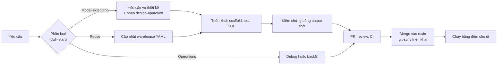
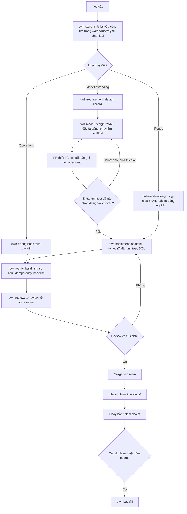
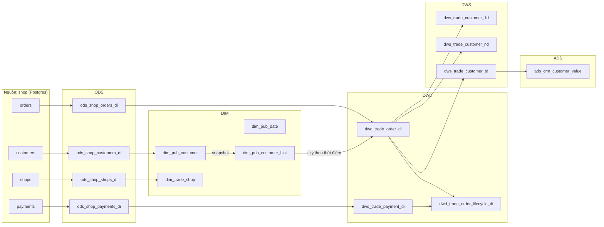
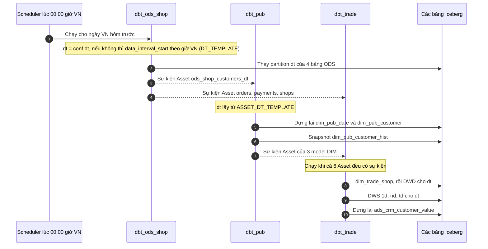
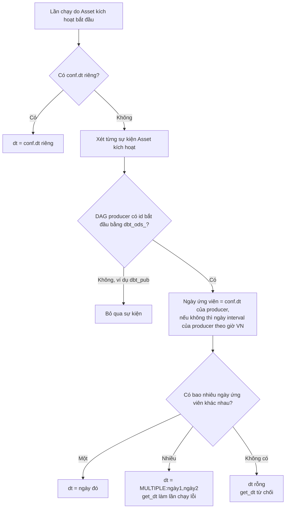
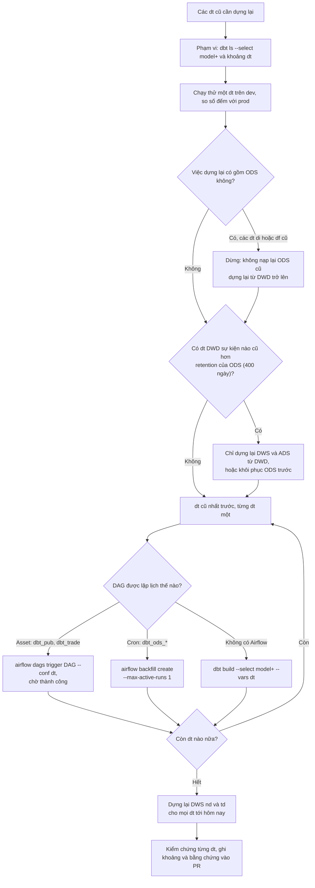

[English](../../en/guides/data-model-development.md)

# Hướng dẫn phát triển data model

Tài liệu này giải thích cách chúng ta thêm hoặc sửa dữ liệu trong kho dữ liệu (data warehouse) example-dwh: từ một
yêu cầu cho tới một model chạy mỗi đêm. Tài liệu dùng đúng tên skill, lệnh, file và rule có trong repo này, và lấy
domain tham chiếu `trade` (đơn hàng và thanh toán của các shop) làm ví dụ xuyên suốt.

Bản thân các rule nằm trong `docs/standards/`, còn các bước quy trình nằm trong `skills/`. Tài liệu này không thay
thế chúng mà chỉ cho thấy chúng khớp với nhau thế nào. Khi tài liệu này và một file rule nói khác nhau, file rule
đúng.

## Mục lục

1. [Dành cho ai và cách đọc](#1-dành-cho-ai-và-cách-đọc)
2. [Thuật ngữ](#2-thuật-ngữ)
3. [Quy trình từ đầu đến cuối](#3-quy-trình-từ-đầu-đến-cuối)
4. [Các layer và quan hệ phụ thuộc](#4-các-layer-và-quan-hệ-phụ-thuộc)
5. [Lần chạy hằng ngày](#5-lần-chạy-hằng-ngày)
6. [Backfill và dữ liệu đến muộn](#6-backfill-và-dữ-liệu-đến-muộn)
7. [Ví dụ thực tế: domain trade được xây thế nào](#7-ví-dụ-thực-tế-domain-trade-được-xây-thế-nào)
8. [Làm việc với công cụ AI](#8-làm-việc-với-công-cụ-ai)
9. [Checklist](#9-checklist)
10. [Câu hỏi thường gặp](#10-câu-hỏi-thường-gặp)

## 1. Dành cho ai và cách đọc

Tài liệu dành cho mọi người sửa kho dữ liệu: data engineer, analytics engineer, reviewer, data architect, và các
công cụ AI viết code mà họ dùng. Bạn cần biết SQL cơ bản. Bạn không cần biết trước Kimball hay Alibaba OneData;
mục 2 giải thích mọi thuật ngữ.

Cách đọc:

- **Mới vào repo?** Đọc mục này, rồi phần thuật ngữ (mục 2), rồi ví dụ thực tế (mục 7).
- **Sắp làm một thay đổi?** Đi theo mục 3 từng bước, và dùng checklist ở mục 9.
- **Đang trực (on call) hoặc phải dựng lại dữ liệu?** Đọc mục 5 và 6.

### Toàn bộ quy trình trong năm phút

Mọi thay đổi dữ liệu bắt đầu bằng việc **phân loại**. Loại (class) quyết định con đường đi. Một thay đổi thêm khái
niệm mới vào kho (một domain, một business process, một dimension dùng chung, một atomic metric, một hệ thống nguồn
mới, hoặc một grain mới) là **model-extending** (mở rộng model): nó cần một bản thiết kế viết ra và sự phê duyệt
của data architect trước khi ai đó viết SQL. Một thay đổi chỉ dùng lại các khái niệm đã có là **reuse** (tái sử
dụng): nó cập nhật YAML thiết kế rồi đi thẳng vào code. Một lần chạy lỗi, chạy lại, backfill hay vấn đề hiệu năng
là **operations** (vận hành). Con đường nào cũng kết thúc bằng một pull request (PR) có output lệnh thật làm bằng
chứng. Sau khi merge, git-sync triển khai code, và Airflow dựng từng layer mỗi đêm cho ngày nghiệp vụ Việt Nam `dt`.



## 2. Thuật ngữ

Thuật ngữ được nhóm theo chủ đề. Cột "Ở đâu" chỉ file hoặc thư mục định nghĩa hay dùng thuật ngữ đó. Các thuật ngữ
kỹ thuật giữ nguyên tiếng Anh như cách các nhóm dữ liệu Việt Nam vẫn dùng.

### Layer và các khái niệm thiết kế

| Thuật ngữ | Nghĩa dễ hiểu | Ví dụ trong trade | Ở đâu |
|-----------|---------------|-------------------|-------|
| ODS (operational data store, kho dữ liệu vận hành) | Bản sao của một bảng nguồn, mỗi ngày một partition. Chỉ ODS được đọc `source()`. | `ods_shop_orders_di` | `dags/dbt/models/ods/`, STD-01-02 |
| DIM (layer dimension, chiều) | Các bảng mô tả "ai, cái gì, ở đâu" của fact, mỗi key một dòng hiện tại. | `dim_pub_customer`, `dim_trade_shop` | `dags/dbt/models/dim/`, `04-dimensions.md` |
| DWD (data warehouse detail, chi tiết) | Các bảng fact ở mức nguyên tử: mỗi sự kiện nghiệp vụ một dòng. | `dwd_trade_order_di` | `dags/dbt/models/dwd/`, `05-facts.md` |
| DWS (data warehouse summary, tổng hợp) | Bảng tổng hợp từ DWD theo một grain và một chu kỳ thống kê. | `dws_trade_customer_1d` | `dags/dbt/models/dws/`, `07-dws-ads.md` |
| ADS (application data service, dữ liệu cho ứng dụng) | Bảng làm cho một ứng dụng hoặc một bản xuất (export) có tên cụ thể. | `ads_crm_customer_value` (export CRM) | `dags/dbt/models/ads/`, STD-07-05 |
| Data domain (miền dữ liệu) | Một mảng nghiệp vụ sở hữu các process và bảng; là một token trong tên bảng. | `trade`, `crm` | `warehouse/domains.yml`, STD-03-01 |
| Business process (quy trình nghiệp vụ) | Sự kiện sinh ra fact. Mỗi bảng fact một process. | `order`: "Khách đặt một đơn ở một shop." | `warehouse/processes.yml`, STD-00-01 |
| Bus matrix (ma trận bus) | Bảng đối chiếu các process với những dimension mà mỗi process dùng, kèm tên vai trò (role). | `order` dùng `date` với vai trò `order_date`, `customer`, `shop` | `warehouse/bus_matrix.yml`, STD-03-03 |
| Conformed dimension (dimension dùng chung) | Một dimension duy nhất được mọi process cần nó dùng chung, để các báo cáo khớp nhau. | `customer` (scope `pub`) | `warehouse/dimensions.yml`, STD-00-05 |
| Scope `pub` | Dimension dùng chung giữa các domain; bảng của nó tên là `dim_pub_<tên>`. | `dim_pub_date`, `dim_pub_customer` | STD-02-02 |

### Fact và dimension

| Thuật ngữ | Nghĩa dễ hiểu | Ví dụ trong trade | Ở đâu |
|-----------|---------------|-------------------|-------|
| Grain (độ hạt) | Một câu nói một dòng là gì: "mỗi … một dòng". Viết trước khi chọn cột. | "Mỗi đơn hàng một dòng, vào ngày Asia/Ho_Chi_Minh mà đơn được đặt." | `processes.yml`, STD-00-02, STD-05-02 |
| Fact (sự kiện đo lường) | Một sự kiện nghiệp vụ có số đo, lưu ở DWD. | một đơn hàng với `order_amt` | `05-facts.md` |
| Transaction fact (fact giao dịch) | Mỗi sự kiện một dòng; không bao giờ cập nhật sau đó. | `dwd_trade_order_di`, `dwd_trade_payment_di` | STD-05-01, STD-05-08 |
| Accumulating snapshot (snapshot tích lũy) | Mỗi lần chạy của một process một dòng, được cập nhật khi các mốc (milestone) xảy ra (merge theo key). | `dwd_trade_order_lifecycle_di` (đặt, rồi thanh toán) | STD-01-05, STD-08-05 |
| Dimension (chiều) | Các thuộc tính mô tả dùng để lọc và nhóm fact. | `customer` với `customer_name`, `city` | `dimensions.yml` |
| Natural key (khóa tự nhiên) | Id của hệ thống nguồn. Hậu tố cột `_id`. | `customer_id` | STD-02-08 |
| Durable key / surrogate key (khóa bền / khóa thay thế) | `<dimension>_key`: hash của natural key (`dbt_utils.generate_surrogate_key`). Nó không đổi giữa các phiên bản, nên fact tự tính được mà không cần tra bảng. | `customer_key` | STD-04-02, STD-05-06 |
| SCD4 | Slowly changing dimension loại 4 (dimension thay đổi chậm): `dim_*` giữ dòng hiện tại; `dim_*_hist` giữ mọi phiên bản, lấy từ dbt snapshot của `dim_*`. Mặc định của chúng ta. | `dim_pub_customer` + `dim_pub_customer_hist` | STD-04-01, STD-04-03 |
| SCD1 | Dimension không giữ lịch sử (chỉ có thuộc tính hiện tại). | `dim_trade_shop`, `dim_pub_date` | STD-04-04 |
| Thuộc tính historical và current | Historical (lịch sử): fact cần giá trị đúng như tại thời điểm sự kiện. Current (hiện tại): đọc từ `dim_*` lúc truy vấn. | `customer.city` là historical; `customer_name` là current | `dimensions.yml`, STD-04-04 |
| Point-in-time (PIT) join (join theo thời điểm) | Join fact với `dim_*_hist` theo durable key và `event_at` nằm trong `[valid_from, valid_to)`, rồi lưu giá trị lên fact. | `customer_city` trên `dwd_trade_order_di` | STD-05-05 |
| Special members (thành viên đặc biệt) | Hai key dành riêng trong mọi DIM: `'-1'` Unknown (natural key null hoặc không tìm thấy) và `'-2'` Not applicable (không áp dụng). | `pay_date_key = '-2'` cho đơn chưa thanh toán | STD-04-06 |
| Inferred member (thành viên suy đoán) | Dòng DIM giữ chỗ cho một key đã tới fact trước khi dòng dimension của nó tới. | (chỉ có trong rule; `is_inferred`) | STD-04-07, STD-12-04 |
| Role-playing dimension (dimension đóng nhiều vai) | Một dimension được một process dùng nhiều lần dưới các tên vai trò. | `date` với vai `order_date` và `pay_date` | STD-04-10 |
| Degenerate dimension (dimension suy biến) | Một id giao dịch giữ trên fact, không có bảng DIM. | `order_id` trên `dwd_trade_payment_di` | STD-04-10 |
| Dimension denormalization (phi chuẩn hóa dimension) | Chép một thuộc tính current hay được lọc lên fact, vẫn giữ cột `_key`. Khác với degenerate dimension. | `shop_name` chép cạnh `shop_key` | STD-05-07 |

### Metric (chỉ số)

| Thuật ngữ | Nghĩa dễ hiểu | Ví dụ trong trade | Ở đâu |
|-----------|---------------|-------------------|-------|
| Atomic metric (chỉ số nguyên tử) | Process + số đo + phép gộp (`sum`, `count`, `count_distinct`, `min`, `max`). Không có chu kỳ, không có bộ lọc. | `order_amt` (tổng tiền đơn) | `metrics.yml`, STD-06-01 |
| Modifier (bộ lọc nghiệp vụ) | Một bộ lọc nghiệp vụ có kiểu, khai báo một lần và dùng lại. | `app` (`channel = 'app'`, kiểu `channel`) | `modifiers.yml`, STD-06-05 |
| Statistical period (chu kỳ thống kê) | Khung thời gian của derived metric: `1d` (ngày dt), `nd` (n ngày gần nhất, n do metric cố định), `td` (toàn bộ lịch sử tới dt), `1w` (7 ngày gần nhất, tách ra từ một bảng `nd` quá rộng); ngoài ra còn `hh`, `mm`. | `1d`, `nd` với `days: 30`, `td` | `periods.yml`, STD-06-06 |
| Derived metric (chỉ số phái sinh) | Atomic metric + một chu kỳ + modifier (tùy chọn) + grain. Tên: `{modifiers}_{atomic}_{agg}_{period}`. | `app_order_amt_sum_1d`, `order_amt_sum_30d` | `metrics.yml`, STD-06-02, STD-06-04 |
| Calculated metric (chỉ số tính toán) | Công thức trên các derived metric, cho tỷ lệ và trung bình. Không bao giờ lưu dưới ADS. | `avg_order_amt_td = order_amt_sum_td / nullif(order_cnt_td, 0)` | STD-06-03, STD-07-06 |
| Additivity (tính cộng được) | Metric có cộng được qua mọi dimension không (`additive`, `semi_additive`, `non_additive`). | `order_amt` là additive | STD-05-04 |

### Thời gian, partition và kiểu nạp

| Thuật ngữ | Nghĩa dễ hiểu | Ví dụ trong trade | Ở đâu |
|-----------|---------------|-------------------|-------|
| `dt` | Ngày partition: ngày nghiệp vụ Asia/Ho_Chi_Minh, không phải ngày UTC và không phải ngày chạy job. Model đọc nó bằng `get_dt()`. | `dt = 2026-11-02` | STD-08-01, STD-08-02, `macros/get_dt.sql` |
| Partition (phân vùng) | Một lát `dt` của bảng Iceberg. Đơn vị để nạp, chạy lại, backfill và retention. | partition `2026-11-02` của `dwd_trade_order_di` | STD-08-01 |
| Partition replacement (thay partition) | Một `pre_hook` có điều kiện `is_incremental()` xóa partition `dt`, rồi model append. Chạy lại an toàn. | mọi model ODS, DWD (giao dịch) và DWS | STD-08-04 |
| Nguồn `di` | Daily incremental (nạp tăng dần hằng ngày): các dòng có watermark (ví dụ `updated_at`) rơi vào ngày dt. | `shop.orders`, `shop.payments` | STD-08-06 |
| Nguồn `df` | Daily full (nạp toàn bộ hằng ngày): mỗi ngày chép toàn bộ bảng. | `shop.customers`, `shop.shops` | STD-08-06 |
| Watermark (mốc) | Cột quyết định dòng `di` nào thuộc về một ngày. | `updated_at` | STD-08-06 |
| Late data (dữ liệu đến muộn) | Fact tới kho sau khi `dt` của nó đã được nạp. Chỉ xử lý bằng cách chạy lại các dt bị ảnh hưởng. | đơn 2 và 4 trong dữ liệu test | STD-08-07 |
| Backfill (nạp bù) | Chạy lại các partition `dt` trong quá khứ, cũ nhất trước, từng ngày một. | sau khi sửa logic trong `dwd_trade_order_di` | `skills/dwh-backfill/` |
| Retention (thời gian lưu giữ) | Mỗi layer giữ partition cũ bao lâu: ODS 400 ngày, DWD và DWS 3 năm, DIM và `_hist` mãi mãi, ADS 400 ngày. | ghi đè bằng `config.meta.retention_days` | STD-08-08 |

### Điều phối (orchestration)

| Thuật ngữ | Nghĩa dễ hiểu | Ví dụ trong trade | Ở đâu |
|-----------|---------------|-------------------|-------|
| DAG | Một workflow Airflow. Mỗi hệ thống nguồn một DAG (`dbt_ods_<source>`) và mỗi domain một DAG (`dbt_<domain>`). | `dbt_ods_shop`, `dbt_pub`, `dbt_trade` | `dags/`, STD-11-01 |
| Cosmos | Thư viện biến một tập chọn dbt thành DAG Airflow (`cosmos.DbtDag`), mỗi node dbt một task, và phát một Asset cho mỗi model. | `dbt_dag_kwargs(select=["tag:ods_shop"])` | `dags/_common/dbt.py`, STD-11-02 |
| Asset / DAG kích hoạt bởi Asset | Một Airflow Asset đại diện cho một bảng. DAG lập lịch theo Asset sẽ chạy khi các producer (DAG tạo ra Asset) chạy xong, thay vì dò bằng sensor. | `dbt_trade` chờ sáu Asset | `dags/_common/assets.py`, STD-11-04 |
| `conf.dt` | `dt` bạn truyền cho một lần chạy tay hoặc backfill: `--conf '{"dt": "2026-11-02"}'`. Nó ghi đè ngày được tính. | `airflow dags trigger dbt_trade --conf '{"dt": "2026-11-02"}'` | `dags/_common/dates.py` |
| `DT_TEMPLATE` / `ASSET_DT_TEMPLATE` | Các template Jinja tính `dt` trong DAG chạy theo cron và DAG kích hoạt bởi Asset. | xem mục 5 | `dags/_common/dates.py`, STD-11-03 |
| git-sync | Sidecar clone nhánh `main` vào Airflow (`subPath: dags`). Merge chính là triển khai. | `deploy/helm/values.example.yaml` | README "How it runs in production" |

### Quy trình và công cụ

| Thuật ngữ | Nghĩa dễ hiểu | Ví dụ trong trade | Ở đâu |
|-----------|---------------|-------------------|-------|
| Change class (loại thay đổi) | `Model-extending`, `Reuse` hoặc `Operations`, do `dwh-start` chọn. Nếu hai loại cùng khớp, lấy loại cao hơn; nếu không chắc, coi là model-extending. | thêm `trade` là model-extending | `skills/dwh-start/` |
| Design record (bản ghi thiết kế) | `docs/designs/YYYY-MM-DD-<topic>.md`: yêu cầu, process, grain, dimension, metric, nguồn, bên dùng, câu hỏi mở. | `docs/designs/2026-11-04-trade-reference-domain.md` | `skills/dwh-requirement/` |
| Design gate (cổng thiết kế) / `design-approved` | PR nào thêm domain, process, dimension hay atomic metric phải link tới một design record và mang nhãn `design-approved` do data architect gắn. CI kiểm tra (DWH-G01, DWH-G02). | | `.github/workflows/design-gate.yml`, STD-03-05 |
| Scaffold (khung sườn) | `dwh scaffold` in ra (hoặc với `--write` thì tạo) file `.sql` và `.yml` của model mới từ thiết kế, có sẵn test và description để trống. | `dwh scaffold dws_trade_customer_1d ...` | `tools/dwh/`, STD-09-07 |
| Contract (hợp đồng) | Danh sách cột và kiểu dữ liệu được dbt cưỡng chế trên DIM, DWD và DWS. Build sẽ lỗi nếu SQL trả về cột hoặc kiểu khác. | `contract: {enforced: true}` | STD-09-03 |
| Mã lint `DWH-*` | Kiểm tra tự động, dạng `DWH-<họ><hai chữ số>`: Y (YAML), N (đặt tên), L (layer), M (metric), B (bus matrix), T (test), D (description), S (nguồn), G (design gate), R (rulebook). | `DWH-L04` "dependency not allowed by the layer rules" | `tools/dwh/src/dwh/codes.py` |
| Rule ID `STD-NN-MM` | Mỗi rule trong rulebook; `NN` là số file (`00`–`12`). Mỗi rule là MUST (bắt buộc) hoặc SHOULD (nên), có ví dụ đúng và sai. | STD-07-04 "Build DWS only when it pays" | `docs/standards/` |
| Skill | Tài liệu quy trình ngắn (các bước, dấu hiệu cảnh báo) mà người hoặc công cụ AI làm theo cho một giai đoạn. Có tám skill. | `dwh-verify` | `skills/*/SKILL.md` |
| Eval (bài đánh giá) | Kịch bản test chạy không giao diện (headless) để xem skill có thay đổi hành vi của agent AI không, do một LLM làm giám khảo chấm. | `evals/scenarios/scaffold-dws.md` | `evals/` |

## 3. Quy trình từ đầu đến cuối

Sơ đồ cho thấy mọi bước từ yêu cầu đến lần chạy hằng đêm. Thay đổi model-extending đi qua design gate; thay đổi reuse
bỏ qua nó; thay đổi operations bỏ qua toàn bộ phần thiết kế. Một góp ý review hoặc một check CI đỏ sẽ đưa bạn quay
lại.



Các mục con dưới đây nói về từng bước: skill dùng, đầu vào và đầu ra, lệnh, các rule hay được viện dẫn nhất, và các
lỗi thường gặp. Trong các lệnh, `dwh` là viết tắt của `uv run --project tools/dwh dwh`.

### 3.1 Yêu cầu

- **Skill:** chưa có.
- **Đầu vào:** một câu hỏi từ ai đó, ví dụ "nhóm CRM cần giá trị đơn hàng trung bình của mỗi khách".
- **Đầu ra:** một yêu cầu bạn nhắc lại được trong một câu: câu hỏi nghiệp vụ, ai dùng câu trả lời, và hạn chót.
- **Lỗi thường gặp:** bắt đầu từ bố cục báo cáo thay vì từ business process (dấu hiệu cảnh báo của
  `dwh-requirement`).

### 3.2 Phân loại

- **Skill:** `dwh-start`. Mọi thay đổi dữ liệu bắt đầu ở đây, kể cả kiểu "gấp lắm, cứ viết SQL đi".
- **Đầu vào:** yêu cầu.
- **Đầu ra:** dòng đầu tiên trong câu trả lời của bạn: `Class: <class>. Path: <skills>.`
- **Cách làm:** tìm những gì đã có trong `warehouse/processes.yml`, `dimensions.yml`, `bus_matrix.yml`,
  `metrics.yml`, `modifiers.yml` và `glossary.yml` (hoặc catalogue sinh bởi `make catalog`). Rồi chọn loại:

| Loại | Dấu hiệu | Con đường |
|------|----------|-----------|
| Model-extending | domain, business process, conformed dimension hoặc atomic metric mới; đổi grain; hệ thống nguồn mới | dwh-requirement → dwh-model-design → dừng chờ người duyệt → dwh-implement → dwh-verify → PR |
| Reuse | derived metric từ một atomic metric đã có; bảng ADS mới; thuộc tính mới trên dimension đã có; sửa logic hoặc sửa lỗi | dwh-model-design (không dừng chờ duyệt) → dwh-implement → dwh-verify → PR |
| Operations | DAG hoặc task lỗi, chạy lại, backfill, hiệu năng | dwh-debug hoặc dwh-backfill → PR |

- **Rule:** STD-00-03 (tái sử dụng trước khi tạo mới), STD-03-05 (thay đổi model-extending cần duyệt).
- **Lỗi thường gặp:**
  - "Metric này rõ ràng là mới." Phần lớn metric "mới" là derived từ một atomic metric đã có.
  - "Cho dashboard nên cần một DWS." Một DWS cần hai bên dùng hoặc bằng chứng hiệu năng (STD-07-04).

### 3.3 Làm rõ yêu cầu (chỉ model-extending)

- **Skill:** `dwh-requirement`. Bước này không sửa YAML và không viết SQL.
- **Đầu vào:** yêu cầu đã phân loại.
- **Đầu ra:** `docs/designs/YYYY-MM-DD-<topic>.md` với các phần Request, Business process, Grain, Dimensions
  (reused / new), Metrics (reused / new), Sources, Consumers, Open questions.
- **Cách làm:** gọi tên business process; viết grain dạng "mỗi … một dòng"; liệt kê các dimension (ai, cái gì, ở
  đâu, khi nào, thế nào) và quyết định với từng thuộc tính là historical hay current; tách mỗi con số được yêu cầu
  thành atomic metric + chu kỳ + modifier + grain; liệt kê với mỗi bảng nguồn kiểu nạp (`di`/`df`), watermark, múi
  giờ và cách xử lý xóa (delete handling); gọi tên bên dùng. Hỏi người yêu cầu từng câu một cho tới khi "Open
  questions" trống.
- **Rule:** STD-00-01, STD-00-02, STD-05-01, STD-06-01 tới STD-06-03.
- **Lỗi thường gặp:**
  - "Grain: tổng hợp theo ngày" cho một fact mới. Bảng tổng hợp là một DWS dựng trên một DWD nguyên tử.
  - Một atomic metric mới trong khi process và số đo của nó đã tồn tại dưới tên khác.

### 3.4 Thiết kế model

- **Skill:** `dwh-model-design`.
- **Đầu vào:** design record (model-extending) hoặc thay đổi reuse đã thống nhất.
- **Đầu ra:** `warehouse/*.yml` đã cập nhật, đặc tả cho từng bảng, và một lần chạy thử scaffold cho mỗi model mới.
- **Lệnh:**

```bash
make validate   # cho tới khi báo 0 finding(s)
uv run --project tools/dwh dwh scaffold dws_trade_customer_1d --from dwd_trade_order_di --grain customer_key \
  --metric order_amt_sum_1d order_cnt_1d   # không --write: chỉ in file, lộ ra lỗi đặt tên và thiết kế
```

- **Cách làm:** sửa YAML theo thứ tự: `glossary.yml`, `domains.yml`, `processes.yml`, `dimensions.yml`,
  `bus_matrix.yml`, `modifiers.yml`, `metrics.yml`. Đặc tả mọi bảng: layer và tên, grain một câu, key, cột, model
  upstream, kiểu nạp (thay partition hay merge), lịch sử, partition `dt`.
- **Rule:** STD-02-* (đặt tên), STD-03-03 (bus matrix), STD-04-01, STD-06-04 (tên metric), STD-07-02 (mỗi DWS một
  chu kỳ), STD-07-04.
- **Lỗi thường gặp:**
  - "Cứ để mọi thuộc tính là historical cho chắc." Mỗi thuộc tính historical tốn một point-in-time join.
  - "Gộp metric 1d và 7d vào một DWS." Mỗi bảng DWS một chu kỳ.

### 3.5 Design gate (chỉ model-extending)

- **Ai:** một data architect. `CODEOWNERS` tự động yêu cầu review từ chủ sở hữu của `/warehouse/`, `/tools/dwh/`,
  `/.github/` và `/docs/en/specs/`.
- **Đầu vào:** một PR chứa design record và YAML, phần mô tả có link tới `docs/designs/<record>.md` (đường dẫn
  tương đối trong repo; URL GitHub không được chấp nhận).
- **Đầu ra:** nhãn `design-approved` trên PR.
- **CI kiểm tra gì:** `.github/workflows/design-gate.yml` chạy `dwh design-gate`. Nó so `warehouse/*.yml` với nhánh
  gốc. Nếu PR thêm domain, process, dimension hoặc atomic metric, nó đòi nhãn (DWH-G01) và link tới một design record
  có thật (DWH-G02). Check chạy lại khi nhãn được gắn hoặc gỡ.
- **Rule:** STD-03-05.
- **Lỗi thường gặp:**
  - Viết SQL trong lúc chờ. Nếu thiết kế đổi khi review, SQL thành vô ích.
  - "Trưởng nhóm dữ liệu bảo bỏ qua review." Một lời miễn trừ bằng chữ không mở được cổng; chỉ có nhãn mới mở.

### 3.6 Scaffold và triển khai

- **Skill:** `dwh-implement`.
- **Đầu vào:** thiết kế đã duyệt hoặc thay đổi reuse đã thống nhất.
- **Đầu ra:** các model dbt, snapshot, test và thay đổi DAG.
- **Lệnh:**

```bash
uv run --project tools/dwh dwh scaffold dwd_trade_order_di --from ods_shop_orders_di --grain order_id \
  --event-at created_at --write
make sql-lint
make dwh-lint
```

- **Cách làm:**
  1. Scaffold với `--write`. Nó ghi file `.sql` và `.yml` có contract, test grain và test relationships, cùng tag
     chọn (selection tag). Với dimension SCD4, nó ghi thêm snapshot `_hist`. Một DWD giao dịch nhận `--event-at`.
     Accumulating snapshot phải viết tay (scaffold từ chối).
  2. Hoàn thiện YAML: mọi description, mọi `data_type`, mọi cột mà SQL chọn.
  3. Thêm dbt unit test cho logic không tầm thường (khung ngày, PIT join, bộ lọc metric) trong
     `_<folder>__unit_tests.yml`. Chạy chúng và thấy chúng lỗi trước.
  4. Viết SQL: `get_dt()`, `in_business_day()` và `source_ts()`, không bao giờ `{{ ds }}`; dùng CTE; lọc `dt` sớm;
     join theo durable key.
  5. Điều phối: nguồn mới có DAG `dbt_ods_<source>`, domain mới có DAG `dbt_<domain>`. Mỗi model phải được đúng một
     DAG chọn (STD-11-08).
- **Rule:** STD-01-03, STD-05-05, STD-05-08, STD-08-04, STD-09-02, STD-09-03, STD-10-03, STD-10-04, STD-11-08.
- **Lỗi thường gặp:**
  - Viết SQL trước khi test trong `.yml` tồn tại.
  - Sửa file sinh tự động (`CLAUDE.md`, `.claude/`, `.cursor/`). Hãy sửa `AGENTS.md` hoặc `skills/` rồi chạy
    `make sync-agents`.
  - Lưu một tỷ lệ trong DWD hoặc DWS (STD-07-06).

### 3.7 Kiểm chứng

- **Skill:** `dwh-verify`. Không có output lệnh thì không được khẳng định.
- **Đầu vào:** các model đã đổi.
- **Đầu ra:** các lệnh và output thật của chúng, dán vào mô tả PR.
- **Lệnh:**

```bash
docker compose -f dev/compose.yml run --rm airflow \
  'cd dags/dbt && $DBT_EXECUTABLE_PATH build --select dwd_trade_order_di+ --vars "{dt: 2026-11-02}"'
make dwh-lint
make sql-lint
make lint
```

- **Cách làm:**
  1. Build dt đã đổi trên dev: mọi model, unit test và data test phải qua.
  2. Lint: `make dwh-lint`, `make sql-lint` và `make lint` đều báo 0 finding.
  3. Số liệu: số dòng mỗi dt so với nguồn, grain là duy nhất, một số tiền khớp qua từng chặng (ODS ↔ DWD, DWD ↔
     DWS). Câu truy vấn theo ngày sự kiện có trong STD-12-03.
  4. Idempotency (chạy lại cho cùng kết quả): build cùng một dt hai lần; số đếm không được đổi.
  5. Baseline hiệu năng: thời gian chạy, số dòng và byte đầu vào, số dòng đầu ra, số file Iceberg và dung lượng
     (STD-12-05).
- **Rule:** STD-00-06, STD-12-03, STD-12-05.
- **Lỗi thường gặp:**
  - "Tôi đã kiểm chứng một dt khác." Hãy kiểm chứng dt bạn đã đổi, cộng thêm dt kế tiếp.
  - "Tôi sẽ bổ sung bằng chứng sau review." Reviewer không thể kiểm một khẳng định thiếu output.

### 3.8 Review

- **Skill:** `dwh-review`, cho PR của chính bạn trước khi nhờ người khác, và cho PR của người khác.
- **Đầu vào:** PR.
- **Đầu ra:** các phát hiện, đánh dấu **Critical** (số sai hoặc mất dữ liệu), **Important** (vi phạm rule, thiếu
  test hoặc bằng chứng) hoặc **Minor**, mỗi cái có `file:line` và rule ID. Chỉ duyệt khi không còn Critical hay
  Important.
- **Cách làm:** chạy `make dwh-lint` và `make sql-lint` và trích kết quả, rồi kiểm mười mục ở mục 9.2.
- **Lỗi thường gặp:** tin linter về grain và fan-out (nhân dòng khi join). Linter không biết các cột grain có đúng
  không (STD-05-02).

### 3.9 PR và CI

- **Đầu vào:** nhánh đã push.
- **Đầu ra:** các check xanh.
- **Những gì chạy:**
  - `ci.yml`, job `lint`: `make lint`, `make sql-lint`, `make test-repo`, `make dwh-test`, `make validate`,
    `make dwh-lint`, `make check-standards`, `make sync-agents-check`.
  - `ci.yml`, job `stack`: `make image`, `make dev-up`, `make smoke`, `make test-dags`, `make test-integration`,
    `make e2e` trên một stack cục bộ gồm Trino, Postgres và RustFS.
  - `design-gate.yml`: `dwh design-gate` (mục 3.5).
- **Chạy ở máy trước:** `make pre-commit-install` một lần, rồi `make pre-commit` chạy cùng các hook đó trên mọi file
  (ruff, sqlfluff, `dwh validate`, `dwh lint --changed`, `dwh sync-agents --check`, `dwh check-standards`).
- **Lỗi thường gặp:** bỏ qua hook ở máy. CI chạy cùng các check nên hook bị bỏ qua vẫn bị bắt trên PR, nhưng muộn
  hơn.

### 3.10 Merge và triển khai

- **Cách làm:** merge vào `main`. git-sync kéo repo vào Airflow, kiểm tra mỗi 60 giây (`period: 60s`,
  `subPath: "dags"` trong `deploy/helm/values.example.yaml`); Airflow chỉ parse `dags/`. Không có bước triển khai
  riêng cho SQL hay DAG.
- **Ngoại lệ:** các package dbt được đóng sẵn vào image. Sửa `dags/dbt/packages.yml` cần build image mới.
- **Cũng chạy khi merge:** `.github/workflows/catalog.yml` chạy `make catalog` và đăng catalogue thiết kế (bus
  matrix, từ điển metric, glossary, dbt docs) lên GitHub Pages.
- **Lỗi thường gặp:** tưởng model vừa merge đã có lịch sử. Nó bắt đầu từ lần chạy đêm kế tiếp; các ngày cũ hơn cần
  backfill (mục 6).

### 3.11 Chạy hằng ngày và backfill

Sau khi merge, model chạy mỗi đêm (mục 5). Nếu các partition cũ sai hoặc có dòng đến muộn, dựng lại chúng bằng
`dwh-backfill` (mục 6). Một lần chạy lỗi hoặc một con số không khớp thì đi qua `dwh-debug` trước: tìm layer đầu tiên
lệch số, ghi nguyên nhân thành một test lỗi, sửa ở layer thấp nhất bị sai, rồi backfill.

## 4. Các layer và quan hệ phụ thuộc

Các layer chỉ đọc xuống dưới (non-negotiable số 4 trong AGENTS.md, STD-01-03):

- chỉ ODS đọc `source()`;
- DIM và DWD đọc ODS và DIM;
- DWS đọc DWD, DIM và DWS (grain thô hơn);
- ADS đọc DWS và DIM. Nó chỉ được đọc DWD khi `.yml` của nó đặt `config.meta.dwd_reason` (STD-01-04).

Hai trường hợp đặc biệt: một DWD accumulating snapshot đọc các DWD giao dịch của process đó (STD-01-05), và một
snapshot `_hist` đọc `dim_*` hiện tại của nó. `dwh lint` kiểm mọi `ref()` theo các rule này (DWH-L03, DWH-L04).

Các model thật của domain trade:



Ghi chú về sơ đồ:

- `dim_pub_date` được sinh ra (2020-01-01 tới 2030-12-31) và không có upstream.
- Các model DWD và DWS còn khai báo `-- depends_on:` tới các DIM mà chúng giữ key, để DIM được build trước. Bản thân
  key là hash, tính không cần join; chỉ `customer_city` cần join với `_hist`.
- Công cụ BI đọc thẳng star schema DWD + DIM (STD-01-07, spec D13). `ads_crm_customer_value` tồn tại chỉ vì export
  CRM là một ứng dụng có tên cụ thể.

## 5. Lần chạy hằng ngày

Ba DAG dựng domain trade mỗi đêm, cộng thêm một DAG bảo trì hằng tuần.

| DAG | File | Lịch | Chọn |
|-----|------|------|------|
| `dbt_ods_shop` | `dags/sources/dbt_ods_shop.py` | `daily_vn()`: cron `0 0 * * *` theo Asia/Ho_Chi_Minh | `tag:ods_shop` |
| `dbt_pub` | `dags/transform/dbt_pub.py` | Asset của `ods_shop_customers_df` | `tag:domain:pub` |
| `dbt_trade` | `dags/transform/dbt_trade.py` | đủ cả sáu Asset: `ods_shop_orders_di`, `ods_shop_payments_di`, `ods_shop_shops_df`, `dim_pub_customer`, `dim_pub_date`, `dim_pub_customer_hist` | `tag:domain:trade`, `tag:app:crm` |
| `iceberg_maintenance` | `dags/maintenance/iceberg_maintenance.py` | cron `0 3 * * 0` theo Asia/Ho_Chi_Minh (Chủ nhật 03:00) | mọi model ODS, DWD, DWS, ADS có partition theo dt |



### `dt` được chọn thế nào

Code nằm trong `dags/_common/dates.py`; `get_dt()` trong `dags/dbt/macros/get_dt.sql` đọc và kiểm tra giá trị.

**DAG chạy theo cron (`dbt_ods_*`) dùng `DT_TEMPLATE`:** `dt` là `conf.dt` của lần chạy nếu có; nếu không, là thời
điểm bắt đầu data interval (khoảng dữ liệu) của lần chạy, đổi sang Asia/Ho_Chi_Minh, định dạng `YYYY-MM-DD`.
`daily_vn()` chạy lúc 00:00 giờ Việt Nam, và mỗi lần chạy phủ ngày Việt Nam hôm trước `[00:00, 24:00)`. Vậy lần chạy
lúc 00:00 ngày 3 tháng 11 dựng `dt = 2026-11-02`.

**DAG kích hoạt bởi Asset (`dbt_pub`, `dbt_trade`) dùng `ASSET_DT_TEMPLATE`.** Lần chạy như vậy không có cron
interval riêng, nên ngày được lấy từ các lần chạy đã kích hoạt nó:



Ý nghĩa thực tế:

- Chạy tay `dbt_pub` hoặc `dbt_trade` phải truyền `conf.dt`; nó luôn thắng.
- Chạy tay `dbt_ods_shop` cho một ngày cũ (có `conf.dt`) sẽ chuyển ngày đó cho các DAG dùng nó.
- Sự kiện từ `dbt_pub` không bao giờ quyết định ngày của `dbt_trade`, kể cả khi có `conf.dt`. Chỉ các lần chạy
  `dbt_ods_*` mới quyết định. Vì vậy chạy tay `dbt_pub` không đặt ngày cho `dbt_trade`: hãy tự kích hoạt
  `dbt_trade`.
- Nếu các lần chạy producer của những ngày khác nhau dồn vào một lần chạy (một đêm lỗi, một task ODS lỗi, một
  backfill ODS theo khoảng ngày), template sinh ra `MULTIPLE:<ngày>,<ngày>` (cũ nhất trước) và `get_dt()` báo lỗi
  nêu tên các ngày. Một lần chạy chỉ dựng đúng một dt, nên đoán một ngày sẽ bỏ các ngày còn lại không được dựng mà
  không có gì báo lỗi. Hãy chạy tay DAG đó một lần cho mỗi ngày được liệt kê với `conf.dt`, cũ nhất trước (mục 6).
- Khi hoàn toàn không có biến `dt` (chạy tay trên dev), `get_dt()` lấy mặc định là hôm qua theo giờ Việt Nam. Chỉ
  dành cho dev.

Không bao giờ dùng `{{ ds }}` của Airflow: nó là ngày UTC của logical date và lệch một ngày với lịch chạy lúc nửa
đêm giờ Việt Nam (STD-08-02).

### Retention và bảo trì Iceberg

DAG `iceberg_maintenance` hằng tuần chạy `dbt run-operation iceberg_maintenance --args '{dry_run: false}'`. Macro
(`dags/dbt/macros/maintenance.sql`) lấy mọi model thuộc layer ODS, DWD, DWS và ADS có partition theo `dt`, và với
mỗi model đã tồn tại:

1. xóa các partition `dt` cũ hơn `config.meta.retention_days`, hoặc mặc định của layer (ODS 400 ngày, DWD 1095,
   DWS 1095, ADS 400);
2. chạy `optimize`, `expire_snapshots(retention_threshold => '7d')` và `remove_orphan_files(retention_threshold =>
   '7d')`.

Bảng DIM và snapshot được giữ mãi mãi. `ads_crm_customer_value` là bảng đầy đủ không có partition `dt`, nên
retention không cắt nó. Retention giới hạn những gì một backfill dựng lại được (mục 6).

## 6. Backfill và dữ liệu đến muộn

Dùng `dwh-backfill` khi phải dựng lại các partition `dt` cũ: sau khi sửa logic, khi có dữ liệu đến muộn, khi nguồn
sửa dữ liệu, hoặc khi một model mới cần lịch sử. Fact đến muộn chỉ được xử lý theo cách này: chạy lại các dt bị ảnh
hưởng; không bao giờ vá dòng, không bao giờ nạp các ngày trước vào partition hôm nay (STD-08-07).



Các rule đằng sau sơ đồ:

- **Cũ nhất trước, từng dt một, không bao giờ song song.** Ghi song song vào một bảng Iceberg sẽ xung đột và phải
  thử lại. Mỗi lần chạy thay partition của chính nó, nên chạy lại một dt DWD, DWS hay ADS là an toàn.
- **Không nạp lại ODS cũ.**
  - Nguồn `df` chỉ giữ trạng thái hôm nay, nên không thể tạo lại một partition ODS `df` cũ từ nó.
  - Chạy lại một dt ODS `di` cũ sẽ nạp lại các dòng có `updated_at` rơi vào ngày đó tại thời điểm hiện tại. Những
    dòng được cập nhật lại sau đó sẽ mất. Không chạy lại dt ODS `di` cũ trừ khi nguồn giữ lịch sử.
- **Dòng đến muộn vẫn vào đúng chỗ.** Lần chạy DWD sự kiện cho dt D đọc mọi partition ODS từ D trở đi và giữ phiên
  bản sớm nhất của mỗi key (STD-05-08). Chạy lại D sẽ nhặt được các dòng tới ODS sau D. Đơn 2 và 4 trong dữ liệu
  test của trade hoạt động đúng như vậy.
- **Xuôi dòng tới hôm nay.** Dựng lại mọi model downstream, và các bảng DWS `nd` và `td` cho mọi dt từ dt sớm nhất
  bị đổi tới hôm nay, vì giá trị `td` phụ thuộc vào mọi ngày trước đó.
- **Kích hoạt tay các DAG lập lịch theo Asset:**

```bash
airflow dags trigger dbt_trade --conf '{"dt": "2026-11-02"}'   # chờ thành công, rồi tới dt kế tiếp
airflow backfill create --dag-id dbt_ods_shop --from-date 2026-11-02 --to-date 2026-11-02 --max-active-runs 1
```

- **`dt MULTIPLE:<ngày>,<ngày>`.** Kích hoạt tay DAG đó một lần cho mỗi ngày được liệt kê với `conf.dt`, cũ nhất
  trước, chờ từng lần chạy; rồi dựng lại các DWS theo cửa sổ. Chọn một ngày sẽ bỏ các ngày khác không được dựng, và
  không có gì báo lỗi.
- **Dấu hiệu cảnh báo về retention.**
  - Không bao giờ chạy lại một dt DWD sự kiện cũ hơn retention của ODS (400 ngày): pre-hook xóa partition, và các
    ngày ODS đã bị cắt không còn giữ dòng của nó, nên partition rốt cuộc trống.
  - DWS `td` chỉ cộng các ngày DWD còn được giữ (3 năm). Khi các ngày DWD cũ đã bị cắt, `td` dựng lại sẽ nhỏ hơn bản
    gốc.
- **Để yên lịch sử.** Chạy lại snapshot không dựng lại `dim_*_hist`. Một ngày snapshot bị lỡ sẽ mất các phiên bản đó
  vĩnh viễn (STD-11-08). Chỉ dựng lại lịch sử khi có kế hoạch viết ra và được duyệt.
- **Kiểm chứng từng dt** bằng bước 3–4 của `dwh-verify` (số liệu và idempotency), và ghi khoảng ngày cùng bằng chứng
  vào PR.

- **Không kích hoạt `dbt_pub` khi dựng lại từ DWD trở lên.** Các DIM của nó là bảng trạng thái hiện tại, không đọc
  `dt`. Một lần chạy tay `dbt_pub` còn để lại các sự kiện DIM trong hàng đợi của `dbt_trade`, nên mọi đêm sau đó
  `dbt_trade` chạy song song với `dbt_pub` thay vì chạy sau nó (đã đo;
  `docs/en/verification/2026-11-05-plan4-followups.md`). Khi buộc phải chạy tay `dbt_pub`, hãy xoá hàng đợi sau đó:
  `curl -X DELETE <airflow>/api/v2/dags/dbt_trade/assets/queuedEvents`.

## 7. Ví dụ thực tế: domain trade được xây thế nào

Domain `trade` (cùng layer ứng dụng `crm`) được xây bằng cách đi theo các skill. Design record của nó là
`docs/designs/2026-11-04-trade-reference-domain.md`.

### Bước 1: phân loại

Yêu cầu thêm hai domain (`trade`, `crm`), ba process, hai dimension mới và các atomic metric mới. Mỗi thứ đều là dấu
hiệu model-extending:

```text
Class: Model-extending. Path: dwh-requirement → dwh-model-design → stop for human approval → dwh-implement →
dwh-verify → PR.
```

### Bước 2: process và grain (dwh-requirement)

Design record gọi tên mỗi bảng fact một process, và mỗi process một câu grain:

| Process | Loại fact | Grain |
|---------|-----------|-------|
| `order` | transaction | mỗi đơn hàng một dòng, vào ngày Asia/Ho_Chi_Minh mà đơn được đặt |
| `payment` | transaction | mỗi lần thanh toán một dòng, vào ngày được ghi nhận |
| `order_lifecycle` | accumulating snapshot | mỗi đơn hàng một dòng, cập nhật khi đơn được thanh toán |

Các grain này được đưa vào `warehouse/processes.yml` (giữ nguyên tiếng Anh như trong repo):

```yaml
processes:
  - name: order
    domain: trade
    description: A customer places an order in a shop.
    fact_type: transaction
    grain: One row per order, on the Asia/Ho_Chi_Minh day it was placed.
```

Mỗi nguồn được khai báo kèm kiểu nạp: `shop.orders` và `shop.payments` là `di` (watermark `updated_at`);
`shop.customers` và `shop.shops` là `df` (mỗi ngày chép toàn bộ).

### Bước 3: dimension và bus matrix (dwh-model-design)

`customer.city` là historical, vì một đơn hàng phải hiện thành phố của khách tại lúc đặt. `customer_name` chỉ được
đọc ở hiện tại, nên giữ current. `shop` không giữ lịch sử (`scd1`).

Trích `warehouse/bus_matrix.yml`. `date` đóng hai vai trong process lifecycle:

```yaml
bus_matrix:
  - process: order
    dimensions:
      - {dimension: date, role: order_date}
      - {dimension: customer}
      - {dimension: shop}
  - process: order_lifecycle
    dimensions:
      - {dimension: date, role: order_date}
      - {dimension: date, role: pay_date}
      - {dimension: customer}
      - {dimension: shop}
```

### Bước 4: metric (dwh-model-design)

Mỗi con số được yêu cầu được tách thành một atomic metric và các dạng derived của nó. Giá trị đơn trung bình mà CRM
cần là một calculated metric trên hai derived metric đã lưu, nên không có tỷ lệ nào được lưu trong DWS. Trích
`warehouse/metrics.yml`:

```yaml
atomic:
  - name: order_amt
    process: order
    description: Total amount of an order.
    aggregation: sum
    additivity: additive
derived:
  - name: order_amt_sum_td
    atomic: order_amt
    period: td
    grain: [customer]
    description: Order amount per customer over all history.
calculated:
  - name: avg_order_amt_td
    formula: order_amt_sum_td / nullif(order_cnt_td, 0)
    inputs: [order_amt_sum_td, order_cnt_td]
    description: Average order amount per customer over all history.
```

Design record cũng giải thích lý do có các bảng DWS (STD-07-04): hai bên dùng, là ADS `ads_crm_customer_value` và
dashboard tài chính. Mỗi bảng một chu kỳ: 1d, nd (30 ngày) và td là ba bảng.

### Bước 5: design gate

Design record và YAML được đưa vào một PR có link tới `docs/designs/2026-11-04-trade-reference-domain.md`. Không
dòng SQL nào được viết cho tới khi data architect gắn `design-approved`.

### Bước 6: scaffold, từng layer

Mỗi model bắt đầu từ `dwh scaffold --write`, theo thứ tự layer: ODS, rồi DIM và DWD, rồi DWS, rồi ADS. Đây là các
lệnh trong README (ở đây không có `--write`, nên chỉ in file):

```bash
dwh="uv run --project tools/dwh dwh"
$dwh scaffold ods_shop_orders_di --grain order_id
$dwh scaffold dim_pub_customer --from ods_shop_customers_df   # ghi thêm dim_pub_customer_hist
$dwh scaffold dwd_trade_order_di --from ods_shop_orders_di --grain order_id --event-at created_at
$dwh scaffold dws_trade_customer_1d --from dwd_trade_order_di --grain customer_key \
  --metric order_amt_sum_1d order_cnt_1d
$dwh scaffold ads_crm_customer_value --from dws_trade_customer_td --grain customer_key \
  --metric order_amt_sum_td avg_order_amt_td
```

`dim_pub_date` được viết tay (scaffold cần một upstream), `dwd_trade_order_lifecycle_di` cũng vậy (scaffold từ chối
accumulating snapshot). Sau đó description, test và SQL được điền cho tới khi `dwh lint` và `dbt test` sạch.

### Bước 7: point-in-time join

`dwd_trade_order_di` lưu thành phố của khách đúng như lúc đơn được đặt. Nó join `dim_pub_customer_hist` theo durable
key và thời điểm sự kiện. Phiên bản sớm nhất của mỗi key được coi là có hiệu lực từ năm 1900, nên một đơn đặt trước
snapshot đầu tiên sẽ lấy phiên bản đầu tiên được biết. Rút gọn từ model:

```sql
history as (
    select
        customer_key,
        city,
        case
            when valid_from = min(valid_from) over (partition by customer_key)
                then timestamp '1900-01-01 00:00:00 UTC'
            else valid_from
        end as valid_from,
        valid_to
    from {{ ref('dim_pub_customer_hist') }}
)

select
    o.order_id,
    coalesce(h.city, 'Unknown') as customer_city,
    date '{{ get_dt() }}'       as dt
from versions as o
left join history as h
    on
        h.customer_key = {{ dbt_utils.generate_surrogate_key(['o.customer_id']) }}
        and o.created_at >= h.valid_from
        and (o.created_at < h.valid_to or h.valid_to is null)
where o.version_rank = 1
```

`versions` chứa các dòng ODS có `created_at` rơi vào ngày dt, đọc từ mọi partition ODS `dt >= D`; `version_rank = 1`
giữ phiên bản sớm nhất của mỗi đơn (STD-05-08).

### Bước 8: kiểm chứng và chạy

```bash
make dev-up            # dữ liệu nguồn mẫu được nạp vào Postgres
make test-integration  # dựng domain từng ngày và kiểm các giá trị mong đợi
make e2e               # chạy dbt_ods_shop, dbt_pub và dbt_trade trong image Airflow
```

`make e2e` chạy các lệnh sau, truyền ngày cho các DAG lập lịch theo Asset qua `--conf`:

```bash
airflow dags test dbt_ods_shop 2026-11-03
airflow dags test dbt_pub 2026-11-03 --conf '{"dt": "2026-11-02"}'
airflow dags test dbt_trade 2026-11-03 --conf '{"dt": "2026-11-02"}'
```

Các giá trị mong đợi và bằng chứng chạy nằm trong `docs/en/verification/2026-11-05-plan4-verification.md`.

## 8. Làm việc với công cụ AI

`AGENTS.md` là điểm vào cho mọi công cụ AI viết code và cho người. Nó chứa các non-negotiable (điều không thương
lượng), danh sách skill, bảng "Before doing X, read Y" và các lệnh.

Mỗi công cụ nhận skill thế nào:

- **Claude Code** tự nạp các skill từ `.claude/skills/`.
- **Cursor, Copilot, Codex và Gemini** được dặn mở `skills/dwh-start/SKILL.md` trước, rồi tới skill mà nó chỉ tới.
  Cursor còn nhận `.cursor/rules/`.

Các file sau được **sinh tự động và chỉ đọc**: `CLAUDE.md`, `GEMINI.md`, `.claude/skills/`, `.cursor/rules/` và
`.github/copilot-instructions.md`. Muốn đổi chúng, hãy sửa `AGENTS.md` hoặc `skills/`, rồi chạy:

```bash
make sync-agents        # sinh lại các file cho từng công cụ
make sync-agents-check  # lệnh CI chạy: lỗi nếu bị lệch
```

### Eval đo cái gì

`evals/scenarios/` có mười kịch bản, ví dụ `start-urgent-pressure` ("gấp, cứ viết SQL đi" vẫn phải được phân loại)
và `review-bad-model`. Mỗi kịch bản có một prompt, các gạch đầu dòng "Pass if" và "Fail if". `evals/run.sh` chạy
Claude Code headless trên một worktree dùng xong bỏ, có skill hoặc không có (`--without-skills`, mức nền), và
`evals/grade.py` nhờ một LLM giám khảo chấm câu trả lời, theo đa số của ba lần chấm cho mỗi tiêu chí.

```bash
./evals/run.sh new-source-crm --without-skills   # mức nền
./evals/run.sh new-source-crm                    # có skill, tại HEAD
make eval-all                                    # mọi kịch bản, cả hai cách (gọi claude -p có tính phí)
```

Hãy trung thực về kết quả hiện tại. Bản ghi kiểm chứng plan 4 (V3) báo **5 trên 10 kịch bản qua khi có skill, và 1
trên 10 có tính phân biệt** (qua khi có skill và trượt khi không có). Tiêu chí thành công của spec chưa đạt. Có hai lý
do được ghi lại: mỗi bên chỉ chạy agent một lần nên nhiễu, và `docs/standards/` vốn đã dạy nhiều rule, nên mức nền
không có skill cũng qua nhiều kịch bản. Chạy mỗi bên nhiều lần là một follow-up đã ghi trong `evals/README.md`. Vì
vậy hãy coi skill là hướng dẫn quy trình mà người và công cụ làm theo, còn linter và CI là phần cưỡng chế.

## 9. Checklist

### 9.1 Trước khi mở PR

Rút ra từ `dwh-verify` và `dwh-implement`.

- [ ] Dòng đầu của PR nêu loại: `Class: <class>. Path: <skills>.`
- [ ] Model-extending: mô tả có link `docs/designs/<record>.md`, và bạn không viết SQL trước khi có
      `design-approved`.
- [ ] Reuse: đặc tả bảng (layer, tên, grain, key, cột, upstream, kiểu nạp, lịch sử, partition) có trong mô tả.
- [ ] `make validate` báo 0 finding.
- [ ] Mỗi model mới bắt đầu từ `dwh scaffold`; mọi cột có description và `data_type`.
- [ ] Có unit test cho khung ngày, PIT join và bộ lọc metric, và bạn đã thấy chúng lỗi trước.
- [ ] SQL dùng `get_dt()`, `in_business_day()`, `source_ts()`; không `{{ ds }}`; không `select *` ngoài ODS.
- [ ] Mỗi model được đúng một DAG chọn (STD-11-08).
- [ ] `dbt build --select <model>+ --vars "{dt: ...}"` đã qua trên dev cho dt đã đổi và dt kế tiếp.
- [ ] `make dwh-lint`, `make sql-lint` và `make lint` đều báo 0 finding.
- [ ] Số dòng mỗi dt, grain duy nhất, và một số tiền khớp qua từng chặng.
- [ ] Build cùng dt hai lần cho cùng số đếm.
- [ ] Đã ghi baseline hiệu năng (trước và sau với model đã có).
- [ ] Các lệnh và output thật được dán vào mô tả, kể cả chỗ lỗi.
- [ ] `make pre-commit` qua; không sửa tay file AI sinh tự động.

### 9.2 Reviewer

Rút ra từ `dwh-review`. Trước tiên chạy `make dwh-lint` và `make sql-lint` và trích kết quả.

- [ ] **Loại.** Thay đổi model-extending có link design record và mang `design-approved` (DWH-G01/G02).
- [ ] **Grain.** Test grain trong `.yml` khớp với câu grain. Mọi join dùng đủ key của phía kia; fact join dimension
      bằng durable key, không bằng natural id.
- [ ] **Layer.** Phụ thuộc chỉ đi xuống. ADS đọc DWD phải có `config.meta.dwd_reason`.
- [ ] **Tên.** Các token là từ trong glossary. Cột metric theo `{modifiers}_{atomic}_{agg}_{period}`.
- [ ] **Metric.** Mọi cột metric của DWS/ADS là metric đã khai báo. Không lưu tỷ lệ trong DWD/DWS.
- [ ] **Lịch sử.** Thuộc tính historical đến từ PIT join với `dim_*_hist`; fact mang durable key.
- [ ] **Incremental.** Thay partition dt là idempotent. Dữ liệu muộn và việc xóa theo đúng meta của nguồn.
- [ ] **YAML.** Contract và kiểu dữ liệu trên DIM/DWD/DWS; `meta.process` trên DWD; `meta.grain` trên DWS; mọi cột
      có description.
- [ ] **Chi phí Trino.** Lọc `dt` gần chỗ quét; bộ lọc nguồn được đẩy xuống (EXPLAIN có constraint); không
      `select *` ngoài ODS.
- [ ] **Bằng chứng.** Output của `dwh-verify` có trong PR: số đếm, đối soát, idempotency, baseline.
- [ ] Các phát hiện được đánh dấu Critical, Important hoặc Minor, có `file:line` và rule ID. Chỉ duyệt khi không còn
      Critical hay Important.

## 10. Câu hỏi thường gặp

**BI có được đọc thẳng DWD không?**
Có. Mặc định công cụ BI đọc star schema DWD + DIM (và DWS nếu có) (STD-01-07, spec D13). Chỉ lên kế hoạch ADS cho một
ứng dụng, bản export hoặc nhu cầu hiệu năng có tên cụ thể.

**Khi nào tôi cần một DWS?**
Chỉ khi có ít nhất hai bên dùng hoặc bằng chứng hiệu năng đã ghi lại, như baseline của `dwh-verify` (STD-07-04).
Nêu lý do trong description của model. Nếu không, bên dùng đọc DWD + DIM. Mỗi DWS một chu kỳ.

**ADS có được đọc DIM không?**
Có. ADS đọc DWS và DIM. Nó chỉ được đọc DWD khi có `config.meta.dwd_reason` trong `.yml` (STD-01-04), và không bao
giờ đọc ODS.

**Sao không dùng `{{ ds }}`?**
`ds` là ngày UTC của logical date. Data interval của một lần chạy bắt đầu lúc 00:00 giờ Việt Nam, tức 17:00 UTC của
ngày hôm trước, nên `ds` sớm hơn ngày nghiệp vụ một ngày. Dùng `get_dt()` trong model và `DT_TEMPLATE` (hoặc
`ASSET_DT_TEMPLATE`) trong DAG (STD-08-02).

**Nếu số không khớp thì sao?**
Dùng `dwh-debug`. Ghi lại chính xác dt, model và hai con số. Lần theo lineage xuống dưới (ADS → DWS → DWD → DIM/ODS
→ nguồn) và so số dòng cùng một số tiền ở mỗi chặng cho cùng dt. Chặng đầu tiên lệch là nơi có lỗi. Ghi nguyên nhân
thành một test lỗi, sửa ở layer thấp nhất bị sai, rồi backfill. Đừng vá ADS hay dashboard cho khớp.

**Một lần chạy lỗi với `dt MULTIPLE:2026-11-01,2026-11-02`. Có nên chạy lại không?**
Không, nó sẽ lỗi lại. Các lần chạy producer của nhiều ngày đã dồn vào một lần chạy do Asset kích hoạt. Hãy kích hoạt
tay DAG đó một lần cho mỗi ngày được liệt kê với `conf.dt`, cũ nhất trước (mục 6).

**Thêm một cột vào fact có phải thay đổi reuse không?**
Không phải lúc nào cũng vậy. Một cột trên fact có thể đổi grain hoặc thêm một dimension. Thuộc tính mới trên
dimension đã có là reuse; một conformed dimension mới hoặc đổi grain là model-extending. Nếu không chắc, coi là
model-extending.

**Có nên để mọi thuộc tính của customer là historical cho chắc?**
Không. Mỗi thuộc tính historical tốn một point-in-time join. Chỉ đánh dấu historical khi fact cần giá trị tại thời
điểm sự kiện, như `customer.city`.

**Tôi có thể nạp lại ODS của tháng trước không?**
Thường là không. Nguồn `df` chỉ giữ trạng thái hôm nay, còn nạp lại `di` cũ sẽ mất các dòng được cập nhật sau đó.
Hãy dựng lại từ DWD trở lên (mục 6).

**Sửa hướng dẫn cho AI ở đâu?**
Trong `AGENTS.md` hoặc `skills/`, rồi chạy `make sync-agents`. Không bao giờ sửa trực tiếp `CLAUDE.md`, `.claude/`
hay `.cursor/`.
